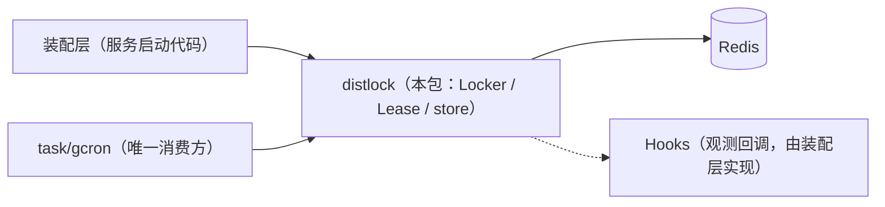
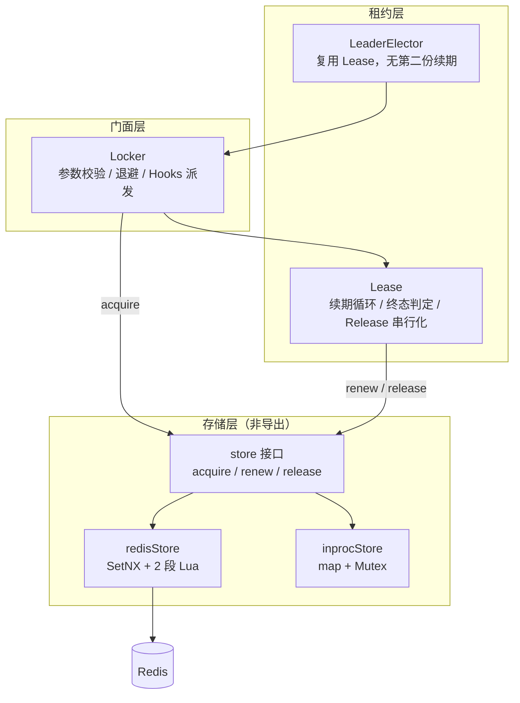
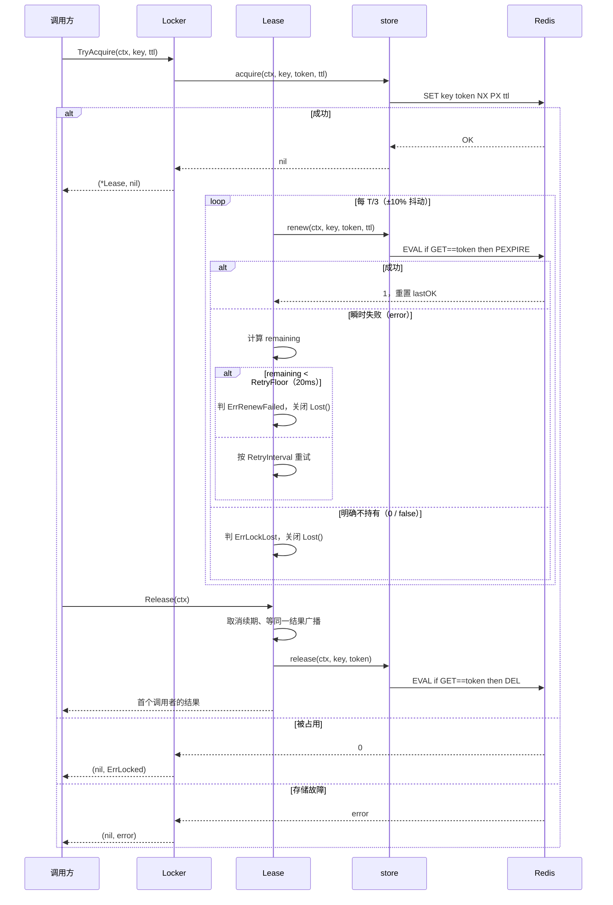
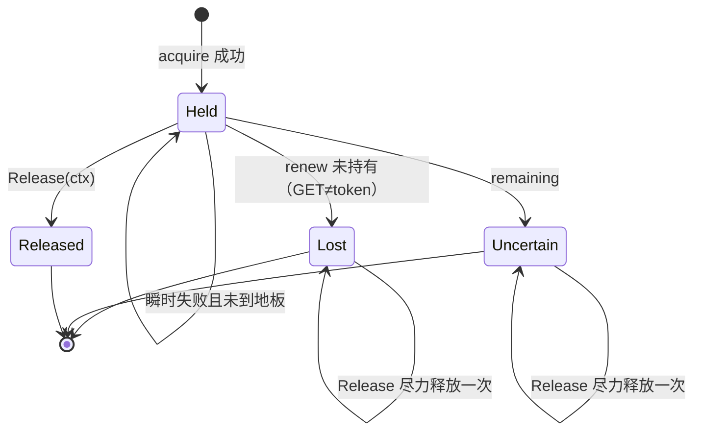

# distlock 包重构技术方案

> 状态：已批准 ｜ 作者：distlock 维护者 ｜ 评审人：task/gcron 维护者 ｜ 拍板人：仓库 owner ｜ 最后更新：2026-11-15
> 实施状态：M1–M4 已落地（新 API / store 接缝 / Lease 状态机 / redsync 单节点适配 / NewMemory / gcron 迁移），`distlock` 与 `task/gcron` 在 `-race` 下全绿；M5 的 clock 注入未做，转入技术债。
> 档位：标准档 ｜ 落点：**C 既有系统的既有模块** ｜ 场景：**主 S3 结构重构**（补充 S2 行为修复、S5 旧 API 下线）｜ 专题：架构设计、API 设计、安全、性能与容量

本文自建需求编号（无上游 PRD），编号在「假设与约束」中声明来源；追溯表见「决策与需求对照」。

## 背景与目标

### 业务背景与现状

`distlock` 是仓库的分布式锁组件，基于 Redis（当前经 redsync/Redlock 封装），并在此之上提供尽力而为的主从选举。唯一生产消费方是 `task/gcron`（跨实例定时任务互斥）。

| 维度 | 现状 | 证据锚点 |
|---|---|---|
| 规模 | 8 个非测试文件，939 行；5 个测试文件 | `distlock/*.go` |
| 分层 | `Locker`（门面）→ `Lease`（自动续期+丢失通知）→ `Factory`（造 Mutex）→ `Mutex`（后端原语） | `distlock/mutex.go:15-41`、`distlock/locker.go:26-28` |
| 后端 | 单一 Redis 实现，经 redsync 完成获取/续期/释放 | `distlock/redis.go:59-108` |
| 消费方 | `task/gcron`：`New(db, cfg, *distlock.Locker, opts...)`，每轮任务 `TryAcquire` + `defer Release` | `task/gcron/cron.go:77`、`task/gcron/cron.go:346-362` |
| 可选性 | `EnableLock` 默认 false；`LockTTL` 默认 60s；释放超时 5s | `task/gcron/config.go:20-23`、`task/gcron/config.go:56-57`、`task/gcron/cron.go:22-23` |
| 已有本地兜底 | 同实例防重叠用 `running.CompareAndSwap`，与分布式锁互补 | `task/gcron/cron.go:336` |

包级文档已明确安全定位：这是 efficiency 锁，不提供 fencing token（`distlock/doc.go:1-18`）。这个定位在本方案中保持不变。

### 痛点分析

痛点集中在两类：**续期状态机的时间预算不成立**，以及**抽象形状把 redsync 的模型泄漏到公开 API**。全部可复现。

**P0-1 一次「慢失败」的续期会当场判死健康租约。** 默认 `cadence = renewTimeout = TTL/3`、`renewDeadline = 2TTL/3`（`distlock/options.go:64-70`）。首次续期在 t≈T/3 发起，若它卡满自身 timeout 直到 t≈2T/3 才返回，随后 `time.Since(lastOK) >= deadline` 立即判定丢失（`distlock/lease.go:229`）。实测（TTL=900ms，默认参数）：t=620ms 触发 `ErrRenewFailed`，整段租约只发生 1 次续期；按计划的下一次重试落在 t=690ms，已超过 600ms 的窗口。此时 Redis key 仍有约 280ms 有效期，属于**提前误杀**。现有回归用例只覆盖「快速失败」（`distlock/lease_test.go:189-211`），慢失败这条路径没有用例。

**P0-2 `Release` 的幂等契约会把错误吞掉。** 入口即置 `released=true` 并让并发调用者直接返回 nil（`distlock/lease.go:130-137`）。实测：第一个调用者卡在 `Unlock` 中 500ms 且最终返回错误时，第二个调用者在 0s 内返回 nil —— 同一把锁得到两个答案；且「第二个 Release 返回 nil」不代表锁已经释放。

**P1 可观测性为零。** `Hooks` 只能逐次传入（`distlock/options.go:112`），全仓检索：除组件自身测试外**没有任何调用方使用过任何 `AcquireOption`**，包括 `task/gcron`。线上丢锁事件没有任何信号；`Hooks` 签名也没有 `ctx`，无法关联 trace/日志。

**P1 错误语义混叠。** `Acquire` 超时返回 `errors.Join(ErrLocked, ctx.Err())`（`distlock/locker.go:91,99`），实测错误串为两行 `"distlock: lock is held by another owner\ncontext deadline exceeded"`，且 `errors.Is` 同时命中两个原因，调用方无法只靠一次判定区分「忙」与「等太久」。`TryAcquire` 不预检 `ctx.Err()`（`distlock/locker.go:44-65`），调用方自身取消会被 redsync 包成 `node #0: context canceled` 后归入「存储故障」。

**P1 参数不自洽被静默改写。** `WithRenewDeadline` 超过 TTL 被改成 TTL、`WithRenewTimeout` 超过 deadline 被改小（`distlock/options.go:83-88`），用户配置错误不会得到任何提示。

**P2 抽象形状泄漏后端模型。** `Factory.NewMutex(key, ttl)` 每次获取新建一个有状态对象，`Mutex.Token()` 在未持有时为空串（`distlock/mutex.go:15-34`、`distlock/redis.go:110`）——这些都是 redsync 的对象模型，被原样搬进了公开 API；`normalizeRedisErr` 需要从 redsync 的 `multierror` 里推断语义（`distlock/redis.go:119-136`）。公开面因此达到 39 个导出符号（10 个类型、8 个函数、13 个方法、1 个常量、7 个哨兵错误）。

**P2 文档与实现不一致。** `distlock/options.go:54,92` 声称重试间隔「带 ±30% 抖动」，实现为 ±10%（`distlock/lease.go:259-268`）。

### 目标与非目标

**业务目标**：让跨实例定时任务互斥在两类部署形态下都可用且可运维——多实例用 Redis，单进程用进程内实现；线上丢锁可被观测。

**技术目标**（均可验证）：

| 编号 | 目标 | 口径 |
|---|---|---|
| R1 | 慢失败续期不得误判丢锁，也不得无限推迟判定 | 在 TTL=900ms、单次续期卡满 timeout 的注入下：丢失时刻 ∈ `[RenewDeadline - RetryFloor, RenewDeadline + RenewTimeout]`；窗口内 `store.renew` 调用次数 ≥2；不存在「remaining < RetryFloor 仍继续尝试」的轮次 |
| R2 | `Release` 结果对所有调用者一致 | 并发 N=8 调用时底层 `Unlock` 恰好执行 1 次，且所有调用者收到同一 error |
| R3 | 丢锁可观测 | `Hooks.OnLost` 在构造期一次性接入，无需逐次调用；回调带 `ctx` |
| R4 | 三态错误可用一次判定区分 | `Acquire` 等待超时返回独立哨兵，不与 `ErrLocked` 同时命中 |
| R5 | 非法 TTL 明确报错 | `ttl < MinTTL`、key 为空在获取时返回 `ErrInvalidConfig`；时间参数全部由 TTL 派生，不存在可传入的自相矛盾参数与静默钳制路径 |
| R6 | 单进程部署可用 | `NewMemory()` 提供的 `*Locker` 在单进程内按 key 互斥 |
| R7 | 选举保持现有行为 | 至多一个 Leader、回调成对、瞬时续期故障不让位 |
| R8 | 公开面收敛 | 删除 `Factory`/`Mutex`/`RedisFactory`/`NewRedisFactory`/`New`/`AcquireOption`/4 个逐次 Option，导出符号 39→≤30（净减 ≥9） |
| R9 | 消费方不回归且改动可控 | ① `task/gcron` 生产代码允许修改，但必须落在本节「生产代码改动清单」内（预计 ≤30 行），清单外的新增改动需重新评审；② `cron_test.go` 的 10 处测试注入点迁移到 miniredis，4 类故障注入各有对应造法；③ 盘点 `LockTTL`/`LeaderConfig.TTL` 的实配值 |
| R10 | 安全边界不变 | 仍为 efficiency 锁、不提供 fencing，文档显式声明 |

**非目标（超出范畴的用例）**：不覆盖多独立 master 的 quorum（当前 `NewRedis(c1,c2,c3)` 的语义），原因是 quorum 的正确性收益依赖 5 个真正独立的故障域，内部场景不具备，保留它只会给出错误安全感；不提供 DB 行租约（列入已知未覆盖）；不引入指标注册表或标准 metrics 接口，先用 `Hooks` 覆盖；不改包路径与包名（D11）。

**反目标（做成了也算失败）**：① 为了让后端"可替换"而引入公开端口/子包，导致公开面反而变大；② 为省依赖去掉自动续期或丢失通知；③ 把内存形态做成 Redis 故障时的自动降级；④ 在 `task/gcron` 里复制一份租约/丢锁判定逻辑，形成两套语义（改动允许，分叉不允许）。

### 约束与非功能需求

| 类型 | 约束 |
|---|---|
| 技术栈 | Go 1.27（`go.mod:3`）；Redis 客户端统一 `github.com/redis/go-redis/v9` |
| 目录约定 | 不接受 `distlock/` 下新增子包；Redis 实现留在根包 |
| 定位 | 就是「基于 Redis 的分布式锁」，不为假想后端预留抽象 |
| 破坏性 | 允许破坏性重构，不提供兼容层（与 v1.36.0 的处置一致） |
| **终局性** | 按终局形态设计，不为过渡保留抽象或双入口；已知未来要加的能力（如选举 `Resign`、`Holder` 查询）必须设计成**纯加法**（新增方法/构造/Option），不允许日后再做破坏性重排。判断标准：如果某个决定"先这样、以后再改"，就不进方案 |
| 兼容边界 | 仓库内唯一消费方 `task/gcron` 同步迁移。**模块已发布到公共 proxy**（`proxy.golang.org/github.com/morehao/golib/@v/list` 返回 200，含 v1.36.2），pkg.go.dev 的 distlock 页面显示 `Imported by: 0`（2026-11-15 查询，见 A1）；组织内全量代码检索为 M2 前的待办 |
| 安全 | 保持 efficiency 锁定位；不引入 fencing（Redis 的 INCR 在异步主从切换后会回退，给不出单调凭证） |
| 可靠性 | 续期节奏与失败预算需满足：`RenewTimeout < RenewInterval`、`RenewInterval + RenewTimeout < RenewDeadline < TTL` |
| 性能 | 稳态每轮任务的 Redis 命令数不增加：获取 1 次 + 释放 1 次；TTL=60s 时续期节奏 20s（TTL/3）。仅在续期失败时会多出重试（窗口内最多 2 次 attempt），属失败路径预算 |

**量化目标（含口径）**：

| 指标 | 现状 | 目标 | 口径 |
|---|---|---|---|
| 包单测耗时 | 13.657s（旧实现）→ 9.8s（新实现，`-race` 11.0s） | ≤15s | 本机 `go test ./distlock/ -count=1`，串行；`-race` 10.7s。未做 clock 注入，时间用例走真实时钟（见技术债） |
| 导出符号数 | 39 | ≤30 | `go doc` 导出清单计数（类型+函数+方法+常量+错误变量） |
| 稳态每轮任务 Redis 命令 | 2 + ⌈执行时长/20s⌉（TTL=60s） | 不增加 | 获取/释放各 1 条；续期 cadence TTL/3；失败重试不计入稳态 |
| 单次获取 RPC 预算 | TTL×10%（`distlock/redis.go:15-20`）：TTL=200ms 时 20ms | TTL=1s 时 ≥100ms | 预算 = `min(1s, TTL/3)`；TTL=1s 时 333ms，TTL=200ms 时 66ms |
| MinTTL | 200ms | 1s | 200ms 下获取预算 66ms、续期节奏 66ms，仅比跨 AZ RTT P99（5–20ms，见 A2）高 3 倍，抖动即超时；1s 下分别为 333ms / 333ms |

### 假设与约束

| 编号 | 内容 | 类型 | 不成立时的后果 |
|---|---|---|---|
| A1 | 仓库外无 `distlock` 生产消费方 | 实测：公共 proxy 可取（200，含 v1.36.2）、pkg.go.dev `Imported by: 0`（2026-11-15）；组织内全量代码检索 `[待核实]`，责任人为仓库 owner、截止 M2 前 | 若存在外部消费方，破坏性改动需补迁移表（`distlock/README.md:101-110` 已有 v1.36 的先例）并由其 owner 签收 |
| A2 | 同机房 Redis RTT P99 在 1–3ms、跨 AZ 5–20ms | `[假设]` | 若 RTT 更大，MinTTL 需按 RTT 上调，获取预算公式不变 |
| A3 | `gcron` 是唯一消费方，且允许同步迁移 | `[待核实]`：检索范围为仓库内 import；仓库外不可见 | 若另有消费方，需先盘点再决定是否保留兼容层 |
| A4 | 需求编号 R1–R10 由本文自建（无上游文档） | `[假设]` | 若后续出现 PRD，按 PRD 编号重映射 |
| A5 | 单进程形态只服务单副本部署，多副本部署必须用 Redis 形态 | `[假设]` | 误配即重复执行，属「方案沉默清单」第 1 条 |

### 版本与迁移策略

`distlock` 已发布到公共 proxy（A1），因此破坏性改动必须有明确的发布与迁移路径：

| 项 | 决定 |
|---|---|
| 版本号 | 沿用仓库既有做法：`v1.x` 内破坏性发布 + CHANGELOG 说明（v1.36.0 的 distlock 重写即先例），不引入 `/v2` 模块路径——多一条路径的维护成本高于收益 |
| 迁移材料 | `distlock/README.md` 的映射表升级为 v1.37（旧符号 → 新符号 → 替代做法），并在 CHANGELOG 顶部给出「一句话迁移指南」 |
| 兼容层 | 不提供。保留 `Factory`/`Mutex` 会直接抵消 R8 的收敛目标 |
| 外部消费方 | 若组织内检索（A1）发现有外部调用，按映射表逐个通知签收；不接受"保留旧符号直到下个版本"的折中 |

### 验收标准

| 项 | 谁验 | 怎么验 | 阈值 |
|---|---|---|---|
| R1 | 组件维护者 | 包内 fake `store` 记录 `renew` 调用次数与时刻；注入一次「卡满 attempt 超时」的续期 | 丢失时刻 ∈ `[RenewDeadline-RetryFloor, RenewDeadline+RenewTimeout]`；`renew` 次数 ≥2；不存在 `remaining < RetryFloor` 后的 attempt |
| R2 | 组件维护者 | 并发 8 个 `Release`，统计底层 unlock 次数与各调用者 error | unlock=1，error 全等 |
| R3 | 组件维护者 + 消费方 | 构造期注入 `Hooks`，触发一次丢锁 | `OnLost` 触发 1 次，回调内可读到 `ctx` |
| R4 | 组件维护者 | `Acquire` 在锁被占用且 ctx 超时 | `errors.Is(err, ErrAcquireTimeout)` 与 `errors.Is(err, ErrLocked)` 不同时成立 |
| R5 | 组件维护者 | 传 `ttl=MinTTL-1ms`、空 key | 返回 `ErrInvalidConfig`；代码中不存在会改写用户输入的钳制分支 |
| R6 | 组件维护者 | 两个 `NewMemory()` 门面争同一 key | 第二个返回 `ErrLocked`；释放后可获取 |
| R7 | 组件维护者 | 现有选举用例 + 瞬时故障注入 | 至多 1 个 Leader；`OnStartedLeading`/`OnStoppedLeading` 各 1 次 |
| R8 | 组件维护者 | `go doc` 导出清单比对 | 导出符号 ≤30（基线 39），且不存在 `Factory`/`Mutex`/`AcquireOption` |
| R9 | 消费方维护者 | `go test ./task/gcron/...` + 逐条比对 `git diff task/gcron/` 与本方案清单 | 测试全绿；生产代码改动全部命中清单且 ≤30 行；无新增锁/租约判定逻辑 |
| R10 | 组件维护者 | 包注释检查 | `doc.go` 含 efficiency 锁与 fencing 声明 |

## 方案设计

### 系统上下文与边界

`distlock` 的边界很窄：它只负责「按 key 的互斥 + 租约存活」，不负责业务幂等、不负责资源侧一致性。下图是本次方案涉及的依赖与边界（箭头为编译期依赖）：



图把 `distlock` 当作一个整体，只画包外依赖：谁构造它（装配层与 `gcron`）、它连谁（Redis）、回调往哪去（Hooks）。包内分层见下一节的总体架构图——两张图不重复画同一条边。

**部署形态**（两种，由装配层显式选择，不在运行期自动切换）：

| 形态 | 构造方式 | 适用 | 互斥范围 |
|---|---|---|---|
| 多实例（默认） | `NewRedis(rdb)` | 副本数 ≥2 的服务 | 跨进程，经 Redis |
| 单实例 | `NewMemory()` | 单副本服务、CLI、本地开发 | 仅进程内 |

**边界外明确不负责**：① 不提供 fencing token，被保护资源若需严格互斥必须自带版本号校验；② 不负责 key 的命名空间治理（调用方拼前缀）；③ 不负责进程退出时的批量释放（租约随进程消失，Redis key 到 TTL 自然过期）；④ 不做 Redis 客户端构造、连接池、日志 Hook（由装配层传入 client）。

### 总体思路

一句话：**把「租约状态机」做成包内唯一的时间权威，其余全部退化为不持状态的协作方**。

具体三步：① 删掉 `Factory`/`Mutex` 两层，Redis 实现经 redsync 适配落在非导出的 `redisStore` 上（单节点退化：获取 `SET NX PX`、续期/释放 Lua CAS）；② `Lease` 用 `context.WithCancelCause` 收敛三套生命周期信号，`Release` 串行化并广播结果；③ 时间预算改成可证明终止的取值：`RenewTimeout = min(1s, T/10)`、单次 attempt 上限取 `min(RenewTimeout, remaining)`，并以 `remaining < RetryFloor(20ms)` 作为丢锁判据（保证终态可达）。

单进程形态不是"降级路径"，而是第二种**显式部署形态**：同一套 `Lease` 语义，backend 换成进程内的 `inprocStore`。

### 总体架构



各节点在正文的对应位置：`Locker`（门面）见「接口设计」，`Lease` 见「续期状态机」，`store` 见「接口设计」的 `store` 契约，`redisStore` 见「存储与键设计」。

| 模块 | 职责 | 不负责 |
|---|---|---|
| `Locker` | 参数校验、阻塞获取的退避、Hooks 派发、token 生成 | 续期调度、状态判定 |
| `Lease` | 唯一的时间权威：续期循环、失败预算、终态与 Cause、Release 串行化 | 存储细节 |
| `store`（非导出） | 单次尝试的三个原语，返回「成功 / 未持有 / 存储不可用」 | 重试、计时、日志 |
| `redisStore` | `SetNX` 获取、Lua CAS 续期/释放 | 租约语义 |
| `inprocStore` | 进程内 map + 互斥，token 校验 | 跨进程语义（它做不到） |
| `LeaderElector` | 抢占 + 让位循环，复用 `Lease` | 自己的续期实现 |

数据所有权：`Locker` 拥有配置与 Hooks；`Lease` 拥有 key/token/时间参数与终态；`store` 只拥有存储连接。

### 核心流程

一次完整的持有包含「获取 → 续期 → 终态 → 释放」四段。下图覆盖正常路径与三条异常分支（瞬时失败、明确不持有、窗口耗尽）：



异常分支的约定：**瞬时失败不改变终态**，只有「明确不持有」或「窗口耗尽」才终结；`Release` 无论此前是否丢锁都会尽力释放一次（value 守卫保证不会误删他人锁）。

### 续期状态机

状态机是本次修复的核心：成功、重试、两种丢锁、正常释放与「丢锁后仍尽力释放」，各对应一条迁移。



`Lost` 与 `Uncertain` 对临界区的含义相同（立即停止工作），区分只为排障；两者之后调用 `Release` 只做一次尽力释放（value 守卫保证不会误删他人锁），**不改变 Cause、不重新打开 `Lost()`**。`Released` 是正常终止，不产生丢失信号。

### 备选方案与取舍

四个备选来自不同约束视角，均含「不做」对照：

| 备选 | 做法 | 代价 | 否决/采纳理由 |
|---|---|---|---|
| A 维持现状 | 只补测试，不改结构 | P0-1 慢失败误杀持续存在；公开面 39 个符号与 redsync 模型长期耦合；单进程形态无解 | 否决：两条 P0 都可复现 |
| B 换成 `bsm/redislock` 全家桶 | 直接引入成熟库，删掉自研 | 无自动续期、无丢锁通知、无选主；需自己写 watchdog 与选举 | 否决：能力倒退，最终仍要写回同等代码 |
| C 拆 `distlock/redis` 子包 + 公开 `Store` 端口 | 核心零依赖，后端可插拔 | 用户明确要求单包；只有一个真实实现，端口是为假想需求预留；消费方测试仍要靠实现 | 否决：抽象动机不成立（见「已知未覆盖」的 DB 租约） |
| D 本方案：单包重排 + redsync 适配 | 见总体架构 | 删除 quorum；保留 redsync 依赖与一层适配 | **采纳**：以最小公开面解决 P0/P1 与单进程形态，同时把锁协议交给库维护 |
| E DB 行租约（正确性方案） | 复用 `gcron` 的库表做租约行，事务内抢占 | 与 `distlock` 定位冲突；需改 `gcron` 存储层 | 否决于本期，列入「已知未覆盖」：若将来要求 correctness，这是更优路径 |

### 技术选型与理由

存储原语有三个候选，评估维度按 must-have 排序：错误语义可精确表达（must）、不引入额外模型泄漏（must）、quorum 能力（nice）、维护成本（nice）。

| 候选 | 错误语义 | 模型泄漏 | quorum | 维护成本 | 结论 |
|---|---|---|---|---|---|
| redsync 适配（采纳） | 单节点下只需 3 类收敛（held / 已过期 / 其他），由适配层归一化 | 适配层内部，不泄漏到公开 API | 有（本期不暴露） | 低（现成） | **采纳**：锁协议由库维护，避免自持 Lua；错误收敛用表驱动用例守住 |
| `bsm/redislock` | 精确（`ErrNotObtained`） | 少 | 无 | 低 | 淘汰：无续期/无选主，仍要自建 |
| go-redis + 自持 2 段 Lua | 精确（返回值直接映射三态） | 无 | 无 | 中（60 行 + 用例 + 长期维护） | 淘汰：与「依赖优先」的仓库规范冲突 |

取舍：redsync 在单节点下就是 `SET NX PX` + 两段 Lua CAS（与 Redis 官方范式一致），真正的算法价值在 quorum——本期不暴露 quorum，但保留实现库。适配层要做三件事：`WithTries(1)` 关掉库内重试、`WithGenValueFunc`/`WithValue` 沿用本组件生成的 token、把 `(ok, err)` 收敛成 held/其他两态。代价是竞争时多一次 release `EVAL`、续期多一层 drift 判断（对 gcron 这类低 QPS 场景可忽略）。

### 决策与需求对照

| 决策 ID | 决策（Y-statement） | 承接需求 | 备选（含不做） | 验证手段 | 状态 | 置信度 |
|---|---|---|---|---|---|---|
| D1 | 单包内建 Redis 实现，因为它是「Redis 锁」而非通用锁 | R8 | C（子包+端口）/ 不做 | 目录与 import 检查 | Accepted | 高 |
| D2 | ~~直接用 go-redis + 2 段 Lua~~ → **Superseded by D14**（自持 Lua 与「依赖优先」规范冲突） | R1、R4 | 保留 redsync / bsm | — | Superseded | — |
| D14 | 用 redsync 适配单节点（`WithTries(1)` + 自定义 value），因为锁协议应交由库维护、避免自持 Lua 的长期成本 | R1、R4、R8 | 自持 Lua / bsm | 存储原语三态用例 + 真实 Redis 端到端 | Accepted | 高 |
| D3 | `Lease` 用 `context.WithCancelCause` 收敛生命周期 | R2、R8 | 保留 3 channel | 状态机用例：终态唯一 | Accepted | 高 |
| D4 | `Release` 首个调用者执行、其余等待并广播同一结果 | R2 | 快速返回 nil（现状） | 并发 Release 用例 | Accepted | 高 |
| D5 | 续期预算改为 `RenewTimeout=min(1s,T/10)` + attempt 上限 `min(RenewTimeout, remaining)` + `remaining<RetryFloor` 判丢，时间参数不外露 | R1、R5 | 现状 T/3；暴露 Timing 值对象；`remaining/2` 夹取（数学上终态不可达） | 慢失败注入用例（`renew` 调用计数与丢失时刻双边断言） | Accepted | 中 |
| D6 | `Hooks` 提到构造期并携带 `ctx` | R3 | 保留 per-call（现状） | 构造期注入 + 丢锁回调用例 | Accepted | 高 |
| D7 | 删除 per-call 选项与 `ErrAcquireTimeout` 之外的错误类型 | R4、R8 | 保留 `AcquireOption` | `go doc` 清单 + 超时用例 | Accepted | 中 |
| D8 | 新增 `NewMemory()` 作为显式部署形态，不做自动降级 | R6 | 不做（唯一消费方已有本地 CAS）/ 自动降级 | 双门面争用用例 + 文档声明 | Accepted | 中 |
| D9 | 删除 `NewRedis(clients...)` 的 quorum 语义 | R8、R10 | 保留 quorum | `go doc` + 变更记录 | Accepted | 中 |
| D13 | `MinTTL` 从 200ms 提到 1s | R5 | 保持 200ms（获取预算 66ms，跨 AZ RTT 抖动即超时） | 构造期/获取期报错用例 + 实配值盘点 | Accepted | 中 |
| D10 | `gcron` 继续直接依赖 `*distlock.Locker`，不引入消费者侧接口 | R9 | 消费者自定义接口 + 适配器 / DB 租约 | 改动清单逐条比对 + 无新增锁逻辑 | Accepted | 高 |
| D11 | 包名保持 `distlock`：主语仍是分布式锁，进程内形态由 `NewMemory` 在名字上区分；改 `redislock` 会把破坏面扩到 import path 且不增加信息 | R8 | 改名为 `redislock` | `go doc` 与 README 检查 | Accepted | 中 |
| D12 | `gcron` 的三套锁门面入口（位置参数 / `Config.Locker` / `WithLocker`）收敛为一套 | R9 | 保留双入口做兼容 | 改动清单逐条比对 | Accepted | 高 |

## 详细设计

### 模块划分与职责

```text
distlock/
  doc.go        包文档：两种形态、安全边界、ctx 契约
  errors.go     哨兵错误
  options.go    Option + Hooks（构造期）
  locker.go     Locker：校验、阻塞获取退避、token 生成、Hooks 派发
  lease.go      Lease：续期循环、终态、Release
  store.go      store 接口（非导出）+ storeRedis/storeMem 共用的错误归一化
  redis.go      redisStore + NewRedis
  mem.go        inprocStore + NewMemory
  election.go   LeaderElector
```

职责边界：`locker.go` 不做时间判定；`lease.go` 不碰 Redis 命令；`redis.go` 不重试、不记日志。三者任一改动都不需要动其他两个。

### 接口设计

```go
package distlock

// Locker 是分布式锁门面。进程内构造一个即可，可并发使用。
type Locker struct{ /* store store; hooks Hooks */ }

func NewRedis(rdb goredis.UniversalClient, opts ...Option) (*Locker, error)
func NewMemory(opts ...Option) *Locker

func (l *Locker) TryAcquire(ctx context.Context, key string, ttl time.Duration) (*Lease, error)
func (l *Locker) Acquire(ctx context.Context, key string, ttl time.Duration) (*Lease, error)

// Lease 是一次占用。所有方法并发安全；零值不可用。
func (l *Lease) Key() string
func (l *Lease) Token() string        // 仅日志/排障，不是 fencing token
func (l *Lease) TTL() time.Duration
func (l *Lease) Context() context.Context   // 任何终态（释放或丢失）都会取消
func (l *Lease) Lost() <-chan struct{}      // 仅"丢失"关闭
func (l *Lease) Cause() error               // nil / ErrLockLost / ErrRenewFailed
func (l *Lease) Release(ctx context.Context) error // 所有调用者阻塞到同一结果

// store 非导出，契约三条：
//  1) 三个方法都只做一次尝试，不内部重试；
//  2) 未持有 / 被占用一律返回 ErrLocked（Locker 原样透出，Lease 映射为 ErrLockLost）；
//  3) 必须尊重 ctx 的取消与 deadline —— 续期丢锁判定依赖这一点。
type store interface {
    acquire(ctx context.Context, key, token string, ttl time.Duration) error
    renew(ctx context.Context, key, token string, ttl time.Duration) error
    release(ctx context.Context, key, token string) error
}
```

**错误表**：

| 错误 | 语义 | 调用方动作 |
|---|---|---|
| `ErrLocked` | 他人持有（`TryAcquire`）或本租约已不持有（内部） | 正常竞争，跳过或不重试 |
| `ErrLockLost` | 底层明确不再持有 | 立即停止临界区 |
| `ErrRenewFailed` | 窗口耗尽仍无法确认 | 同上，按故障排查 |
| `ErrAcquireTimeout` | 阻塞获取等待超时（wrap `ctx.Err()`） | 按超时策略重试或放弃 |
| `ErrInvalidConfig` | key/ttl/时间参数非法 | 修正配置，不重试 |

**契约**：非可重入；续期恒开；获取的 `ctx` 只约束获取、不约束租约；`Release` 幂等且结果一致；`Lease.Context()` 在任何终态取消。`Acquire` 等待超时不再同时命中 `ErrLocked`。

### 存储与键设计

| 项 | 设计 |
|---|---|
| key | 调用方给的字符串，原样使用；无内建前缀（命名空间由调用方拼，见「已知未覆盖」） |
| value | 每次获取生成的随机 token（UUID v7） |
| 过期 | `PX ttl`，续期刷新为完整 TTL |
| 获取 | `SET key token NX PX ttl`；返回 false → `ErrLocked` |
| 续期 | `EVAL`：`if GET==token then PEXPIRE(key, ttl) end`；返回 0 → `ErrLocked` |
| 释放 | `EVAL`：`if GET==token then DEL(key) end`；返回 0 → 视为成功（本来就不持有） |
| 无持久化实体 | 不涉及表结构与实体关系，因此不需要 ER 图；key 的生命周期完全由 TTL 与 value 守卫管理 |

### 续期时间预算与失败判定

| 参数 | 值 | 约束 |
|---|---|---|
| `RenewInterval`（节奏） | `TTL/3`，±10% 抖动 | 抖动上界 `0.367×TTL` < `RenewDeadline` |
| `RenewTimeout`（单次上限） | `min(1s, TTL/10)` | 必须 < `RenewInterval`；TTL ≤10s 时即 `T/10`，TTL=60s 时为 1s |
| `RenewDeadline`（确认窗口） | `TTL×2/3` | 必须 < `TTL`；从「上次成功续期」起算 |
| 单次 attempt 超时 | `min(RenewTimeout, remaining)` | `remaining = RenewDeadline - 距上次成功`；由本地 `context.WithTimeout` 强制，`store` 实现必须尊重 ctx |
| `RetryFloor`（判丢地板） | 20ms | `remaining < RetryFloor` 即判 `ErrRenewFailed`，这是终态可达的判据 |
| `RetryInterval`（失败重试） | `min(TTL/10, remaining)` | 与 attempt 同量级，避免密集重试 |

**为什么必须引入 `RetryFloor`**：如果把 attempt 上限也按 `remaining/2` 夹取，`remaining` 只会等比缩小而永远不 ≤0（每次尝试最多花掉剩余窗口的一半，下一轮还剩一半），终态在数学上不可达，`ErrRenewFailed` 与 `Lost()` 永远不会发生——这是本方案在评审中被指出的缺陷，现已改为「时间比较前置 + 地板判据」。

**终止性复算（TTL=900ms，默认参数）**：t=0 获取成功，`lastOK=0`；t=300 第一次 attempt（上限 `min(90ms, 300ms)=90ms`）→ 390ms 失败，`remaining=210ms`；按 `min(90,210)=90ms` 重试 → t=480 第二次 attempt → 570ms 失败，`remaining=30ms`；t=600 检查时 `remaining=0 < 20ms` → 判 `ErrRenewFailed`。窗口内共 2 次 `store.renew` 调用；丢弃时刻落在 `[600-20, 600+90]ms` 内（下界提前量来自地板判据：剩余窗口不足 20ms 时不再发起无意义的尝试），与 R1 的双边判据一致。

**attempt 由本地计时器兜底**：每次 `store.renew` 都包在 `context.WithTimeout` 里；若某个实现不尊重 ctx（违反 `store` 契约），判定会被推迟到该调用返回——这条风险记入「技术风险」，并在 `store` 接口注释里写成硬约束。

### 单进程形态（NewMemory）

同一套 `Lease` 语义，backend 换成进程内实现。必须写死的语义退化：

| 能力 | Redis 形态 | 内存形态 |
|---|---|---|
| 按 key 互斥 | 跨进程 | 仅进程内（**进程内互斥是真的互斥，不需要 fencing**） |
| TTL | 真实有效期 | 只作校验与日志，不做过期判定（避免 STW 造成假丢失） |
| 续期 | 刷新 Redis TTL | 恒成功（无状态变更） |
| `Lost()` | 可能关闭 | 永不关闭 |
| `ErrRenewFailed` | 可能出现 | 不出现 |
| 选举 | 真选主 | 恒为 Leader（等价于没有选举） |

三条铁律：① 只能显式构造，不进配置字符串选型；② 禁止作为 Redis 故障时的自动降级；③ 文档首句声明「多副本部署会失去跨进程互斥」。

`inprocStore` 实现：`map[string]string` + `sync.Mutex`；`acquire` 发现 key 存在返回 `ErrLocked`；`renew` 校验 token；`release` 校验 token 后删除。不启动后台 goroutine，不做过期清理。**命名不用 `memStore`**：`distlock/election_test.go:17` 已有同名测试类型，同包会冲突。

### 主从选举

`LeaderElector` 结构不变，仅依赖 `*Locker`，复用 `Lease` 的续期与丢失判定（`distlock/election.go:113` 的复用方式保持）。保留的既有行为：

- **成对回调**：每次任期恰好一次 `OnStartedLeading` → 一次 `OnStoppedLeading`，后者携带 `Cause()`（正常让位为 nil）；
- **瞬时续期故障不让位**：只有 `ErrLockLost`/`ErrRenewFailed` 才结束任期，避免领导权抖动（`distlock/election_test.go:216-243` 覆盖）；
- **重试抖动**：`RetryInterval` 默认 `TTL/6` 且带抖动，构造期校验必须 `< TTL`（`distlock/election.go:66-78`）；
- **本地任期计数**：`Term()` 是进程内计数（重启归零），不是集群任期号，文档保持这一措辞。

变化点只有两个：`Cause()` 的判定沿用新的终态机（语义不变）；内存形态下 `LeaderElector` 恒为 Leader 且 `Term()` 每次 `Run` 自增 1，文档说明「等价于没有选举」。主动让位（`Resign`）不在本期范围（见已知未覆盖 G6）。

### 可观测性（Hooks）

```go
type Hooks struct {
    OnAcquire func(ctx context.Context, key string, ttl, elapsed time.Duration, err error)
    OnRenew   func(ctx context.Context, key string, err error)
    OnLost    func(ctx context.Context, key string, cause error)
    OnRelease func(ctx context.Context, key string, err error)
}
func WithHooks(h Hooks) Option
```

四个回调都在构造期设置一次；`OnRenew` 是高频事件（TTL=60s 时每 20s 一次），实现方应只做计数或采样，不写日志。`Hooks` 回调内 panic 由组件 recover 并转成错误返回，避免拖垮续期 goroutine。

### 与 task/gcron 的集成决策

**结论：保留直接依赖 `*distlock.Locker`，不引入消费者侧接口适配层。**

| 维度 | 直接依赖（采纳） | 消费者侧接口 + 适配器 | DB 行租约 |
|---|---|---|---|
| 依赖方向 | `task/gcron → distlock`，无环 | 同左，另加适配器包 | `gcron → DB`，去掉 distlock |
| 改动量 | 生产代码 ≤30 行（清单见下，主要是构造入口与配置文档） | 5–10 行适配 + 双份语义 | 重写抢占/续期/存储层 |
| 测试 | `cron_test.go` 迁移到 miniredis + `NewRedis`（10 处注入点） | 同左，另测适配器 | 需 DB 夹具 |
| 现有能力 | 租约丢失 → 取消 handler → 记 `lock_lost` 全保留 | 同左 | 需重新实现 |
| 何时才该换 | — | 出现第二个消费者且要接不同后端 | 要求 correctness 且接受 DB 压力 |

理由：
1. **依赖方向健康**：`distlock` 只依赖 go-redis 与 redsync，不引入 gorm/框架，`gcron` 反向不依赖任何人。
2. **gcron 用的是租约，不是"锁接口"**：它需要 `Lease.Context()` 在丢锁时取消 handler、并用 `Cause()` 区分 `lock_lost`（`task/gcron/cron.go:346-362,406-418`）。换成消费者自定义接口要同时复制这个语义。
3. **Go 没有协变返回值**：`func(ctx, key) (*distlock.Lease, error)` 无法满足 `func(ctx, key) (gcron.Lock, error)`，必须写适配器——净成本，收益只是"未来可能换 DB 租约"，而后者未立项。
4. **单进程形态由 `NewMemory()` 覆盖**：装配层一行切换，gcron 无需分叉。这正是"让 gcron 引入 distlock"的正当性所在。注意它**不用于** gcron 的单测：`NewMemory` 的租约永不丢失、续期恒成功，而 `cron_test.go` 恰恰要注入「续期失败 → `lock_lost`」，因此测试走 miniredis。
5. **最小面**：gcron 只用到 4 个符号（`Locker`、`Lease`、`MinTTL`、`ErrLocked`，后者见 `task/gcron/cron.go:350`），依赖面已经很窄。

这条结论**不依赖「gcron 不许改」这个前提**：即使允许改 gcron 生产代码，消费者侧接口仍需适配器（Go 无协变返回值）并复制租约语义（`Context`/`Cause`/`Release` 三件套），收益仍只是"未来可能换 DB 租约"，而后者未立项。允许改 gcron 降低的是迁移成本，不改变取舍本身；而 gcron 侧的三入口收敛属于"恰好同批做掉"的终局清理，与本决策相互独立。

**生产代码改动清单（允许改，但必须清单化）**：

| 文件 | 改动 | 理由 | 估算 |
|---|---|---|---|
| `task/gcron/cron.go:77,100-103` | 删掉位置参数 `locker`，改为 `New(db, cfg, opts...)`；门面只从 `WithLocker` 取 | 当前有**三套**等价入口（位置参数、`Config.Locker`、`WithLocker`，见 `cron.go:100-103`、`config.go:26-27`、`option.go:41`）。三选一是终局形态的必要条件 | 8–10 行 |
| `task/gcron/config.go:26-27` | 删掉 `Config.Locker` 字段 | `Config` 应是纯数据（可序列化、可进配置文件），锁门面是依赖不是配置；与 `gcache.Config` 只放纯数据的约定一致 | 2 行 |
| `task/gcron/option.go:38-42` | 注释改为「唯一入口」，并删掉"位置参数优先"的说法 | 旧符号将被删除，且三入口收敛后该说明失效 | 3 行 |
| `task/gcron/config.go:21-23` | `LockTTL` 注释补「必须 ≥ `distlock.MinTTL`（1s）」 | `MinTTL` 从 200ms 提到 1s，配置读者需要知道硬下限 | 1 行 |
| `task/gcron/cron.go:224-226` | 校验失败文案补实际值与下限值 | 现有文案只给下限，排查时看不出配置值 | 1–2 行 |
| `task/gcron/README.md` | 更新 `WithLocker` 示例与 TTL 下限 | 文档面同步（见「兼容性与下线」） | 5–10 行 |

合计 ≤30 行，且都是构造/装配层面；锁语义仍由 `distlock` 独占，`gcron` 不引入任何新的续期或丢锁判定代码（反目标 ④）。这三套入口的收敛**本期一次做完**：本版已经是破坏性发布，留到下次只会再破坏一次，并把"位置参数优先但推荐用选项"的歧义留在文档里。

测试侧才是主要工作量。`cron_test.go` 的依赖面比看起来大：`fakeLockFactory`/`fakeLock` 实现的是本次要删的 `distlock.Factory`/`Mutex`（`task/gcron/cron_test.go:35-90`），`WithLocker(newFakeLocker(...))` 出现 **10 处**（`:424,438,647,686,709,732,755,795,824,887`）。迁移方案如下：

| 现有故障注入 | 现在怎么造 | 迁移后怎么造 |
|---|---|---|
| 抢锁被占用（`notLocked`） | fake `TryLock` 返回 `distlock.ErrLocked` | miniredis 先让另一个 `Locker` 占住同一 key |
| 存储故障（`lockErr`） | fake `TryLock` 返回自定义 error | 关闭 miniredis 实例 → go-redis 返回连接错误 |
| 续期失败 → `lock_lost` | fake `Refresh` 返回 error | 持有租约后关闭 miniredis，等 `RenewDeadline` 耗尽 |
| 加锁/解锁次数断言 | fake 内部计数器 | 查 miniredis 的 key 存在性，或用 go-redis `ProcessHook` 计数 `SET`/`EVAL` |
| `LockTTL: 300ms` 用例 | 300ms | 提到 ≥ `MinTTL`（1s）或改用 `NewMemory()`（该用例只验证互斥，不验证租约时长） |

迁移后这 10 处注入点直接构造 `(*distlock.Locker, error)`，与生产装配一致；代价是 `go test ./task/gcron/` 从当前 26.5s 上升到约 30s（多出的部分来自 miniredis 启动与等待续期窗口），仍在可接受范围。

`New` 的位置参数、`Config.Locker`、`WithLocker` 三套入口在本期收敛为一套（`WithLocker`），清单与理由见上表。收敛后 `Config` 回到纯数据形态，可以安全地序列化进配置文件——这也是仓库里 `gcache.Config` 的既定约定。

## 验证与验收

### 行为基线与等价性验证

重构前先固化当前**可观察行为**，重构后逐条比对。基线来自现有用例（`distlock/lease_test.go`、`locker_test.go`、`redis_test.go`、`election_test.go`）：

| 基线 ID | 行为 | 现有用例 | 重构后期望 |
|---|---|---|---|
| B1 | 抢锁成功/被占/存储故障三态 | `locker_test.go`、`redis_test.go:48-75` | 等价 |
| B2 | 自动续期保活 | `redis_test.go:78-103` | 等价 |
| B3 | 快速瞬时失败不丢锁 | `lease_test.go:189-211`、`redis_test.go:128-154` | 等价 |
| B4 | 明确不持有立即丢锁 | `lease_test.go:235-247` | 等价 |
| B5 | 持续失败超窗口丢锁 | `lease_test.go:214-232` | 等价 |
| B6 | 正常释放不产生丢失信号 | `lease_test.go:251-275` | 等价 |
| B7 | 重复 Release 只 unlock 一次 | `lease_test.go:277-292` | 等价（并新增「结果一致」） |
| B8 | 选举至多 1 Leader、回调成对、瞬时故障不让位 | `election_test.go:151-213,216-243` | 等价 |
| B9 | gcron 记录 `lock_lost`（续期失败触发） | `task/gcron/cron_test.go` 的 fake 注入 | 等价（改用 miniredis 关闭实例来注入） |
| B10 | 续期 RPC 卡住时 Release 有界返回 | `lease_test.go:295-313` | 等价 |

**预期行为差异（bug 修复，需同步改用例）**：

| 差异 | 现状 | 重构后 | 归属 |
|---|---|---|---|
| 慢失败续期 | 当场判 `ErrRenewFailed` | 窗口内保留 ≥2 次尝试，判定时刻不晚于 `deadline+RenewTimeout` | R1 |
| 并发 Release | 第二个调用者立即返回 nil | 所有调用者拿到同一结果 | R2 |
| `Acquire` 超时 | `errors.Join(ErrLocked, ctx.Err())` | `ErrAcquireTimeout`（wrap ctx err） | R4 |
| 参数不自洽 | 静默钳制 | 时间参数不再对外暴露；非法 `ttl` 直接返回 `ErrInvalidConfig` | R5 |
| **`MinTTL` 200ms → 1s** | 200ms 可注册 | `ttl ∈ [200ms, 1s)` 的既有配置在 `TryAcquire` 时返回 `ErrInvalidConfig`；`gcron` 在 `Register` 阶段即报 `ErrInvalidLockTTL`（`task/gcron/cron.go:224-226`），`LeaderConfig.TTL < 1s` 在构造期失败（`distlock/election.go:66`） | R5 |
| 后端 quorum | `NewRedis(c1,c2,c3)` | 删除，单 client | D9 |

### 验证手段

| 层 | 手段 | 覆盖 |
|---|---|---|
| 单测 | `go test ./distlock/ -race -count=10` | 状态机、并发 Release、终态唯一 |
| 集成 | miniredis + go-redis `ProcessHook` 注入（复用 `redis_test.go:106-125` 的注入方式） | 真实命令路径、故障注入、key 被抢占 |
| 真实 Redis | `REDIS_ADDR` 可用时跑端到端（现有 `redis_test.go:196-232`） | 续期保活、释放清理 |
| 消费方回归 | `go test ./task/gcron/...`；`git diff task/gcron/` 逐条对照「生产代码改动清单」，清单外改动即视为范围外 | R9 |
| 文档 | `go doc` 导出清单比对 | R8 |

### 关键假设与证伪实验

**最脆弱的假设**：慢失败是「误杀健康临界区」的主要来源，且把 `RenewTimeout` 降到 `T/10` 不会引入新的可用性下降。若错（例如生产 Redis 的 P99 RPC 经常超过 `TTL/10`），则会出现「续期频繁失败但最终仍保住」的噪声，极端情况下窗口耗尽。

最便宜的证伪实验：在 miniredis 上用 `ProcessHook` 按 1%–10% 概率延迟每次 `EVAL` 到 `TTL/10` 的边界，跑 1000 轮续期，统计 `RenewDeadline` 内成功的比例。判据：成功率 ≥99.9% 视为可接受；否则把 `RenewTimeout` 上调到 `T/6`（仍满足 `< RenewInterval`）并重跑。Plan B：改为「连续 N=3 次失败且 remaining≤0」双条件判定，代价是让位更慢。

### 观察指标与判据

| 指标 | 观察方式 | 判据（上线后 2 周） |
|---|---|---|
| 丢锁次数 | `Hooks.OnLost` 计数（按 `ErrLockLost`/`ErrRenewFailed` 分开） | `ErrRenewFailed` 占比 >20% 说明窗口过紧，调 `RenewTimeout` |
| 竞争失败率 | `Hooks.OnAcquire` 的 `ErrLocked` 比例 | 无明显变化（对照上线前日志中的 `lock not acquired` 计数） |
| 释放失败 | `Hooks.OnRelease` 非 nil 计数 | 0 |
| 任务跳过 | gcron `skipped` run 记录按原因分组 | 「lock store error」计数不增加 |

## 实施计划

### 阶段与里程碑

每阶段可独立上线，前一阶段的产出是后一阶段的验收前提：

| 阶段 | 内容 | 独立验证 |
|---|---|---|
| M0 基线固化 | 把 10 条行为基线补成显式用例；给 `Release` 并发、慢续期两条路径加**当前行为**的失败用例（红）；确定注入接缝（包内 fake `store` + 跨包 miniredis）；**盘点 `Config.LockTTL`/`Task.LockTTL`/`LeaderConfig.TTL` 的实配值与外部 `NewRedis(c1,c2,c3)` 调用**（D9/D13 的落地前提） | 用例能稳定复现 P0；盘点结果落到变更记录与通知名单 |
| M1 P0 修复 | `Release` 串行化广播；续期预算（`RenewTimeout=min(1s,T/10)`、attempt 上限、`RetryFloor` 判丢）；非法 TTL 报错 | B1–B10 全绿 + R1/R2/R5 |
| M2 内部接缝 | 引入非导出 `store` 接口 + `inprocStore` + `NewMemory()`；包内测试（`lease_test.go`/`election_test.go`）切到 fake `store`；`cron_test.go` 10 处注入点迁到 miniredis | 两个包的测试编译并通过；`NewMemory` 可用（R6 提前达成） |
| M3 导出面收敛 | 删除 `Factory`/`Mutex`/`Token`/`RedisFactory`/`New`/逐次 Option；`Hooks` 提构造期；`Acquire` 超时错误拆开；同步 gcron 生产代码清单（≤30 行）与文档面 | `go doc` 清单 ≤30；`task/gcron` 编译通过且改动全部命中清单 |
| M4 Redis 实现切换 | redsync 适配（单节点、`WithTries(1)`、自定义 value、错误收敛在 `redisStore` 内）；quorum 不暴露 | 集成用例全绿；`go doc` 无 redsync 符号泄漏 |
| M5 收尾 | `-race -count=10`；包文档、README 与迁移表 | 包单测 ≤15s（真实时钟）；`-race` 全绿；文档声明两形态与 fencing 边界 |

M2 必须在 M3 之前：`Factory`/`Mutex` 一旦删除，`distlock` 自身的 `lease_test.go`/`election_test.go` 与 `task/gcron/cron_test.go` 会同时编译失败，而替代接缝（`store` + `inprocStore` + miniredis 迁移）正是 M2 的产出。

### 兼容性与下线

**消费者盘点**：仓库内 `distlock` 只被 `task/gcron` 引用（`cron.go`、`config.go`、`option.go`、`cron_test.go`）。仓库外情况按 A1：模块已发布（proxy 200、pkg.go.dev `Imported by: 0`），组织内全量检索在 M0 完成，结果落到通知名单。

**下线清单（S5）**：

| 移除项 | 判据 | 处置 |
|---|---|---|
| `Factory`、`Mutex`、`RedisFactory`、`NewRedisFactory`、`New` | 无生产引用（仅测试与 `gcron` 测试替身） | 直接删除；`gcron` 测试改 miniredis + `NewRedis`（`NewMemory` 不用于测试，见集成决策） |
| `AcquireOption`、`WithRetryInterval/WithRenewDeadline/WithRenewTimeout` 的逐次形态 | 无调用方（全仓检索为空） | 删除；`WithHooks` 移到构造期 |
| `NewRedis(clients ...UniversalClient)` 的 quorum | `TestRedisMultiNodeQuorum` 是唯一使用点 | 删除该用例与能力；变更记录注明 |
| `ErrInvalidKey`/`ErrInvalidTTL`/`ErrInvalidOption`/`ErrNilFactory` | 无外部 `errors.Is` 使用（`gcron` 只用 `ErrLocked`/`MinTTL`） | 合并为 `ErrInvalidConfig`；`ErrInvalidTTL` 的语义并入，错误文案保留 TTL 与 `MinTTL` 数值 |
| `MinTTL = 200ms` 的容忍区间 | 仓库内只有 `cron_test.go:762` 的 300ms 使用点 | 提到 1s；同步改该测试；在变更记录里标明「`ttl < 1s` 从可用变拒绝」 |
| **用户可见文档**：`distlock/README.md`（`:47,:61,:68,:70,:123`）、根 `README.md`（`:265,:269,:274`）、`README.zh.md`（`:221,:230`）、`task/README.md`（`:133,:178`）、`distlock/example_test.go` | 全部描述旧 API；`distlock/README.md:70` 明确邀请外部实现 `Factory` | M3 内同步改写；`distlock/README.md:101-110` 的映射表升级为 v1.37 迁移表（旧→新符号一一对应） |

### 回滚方案

重构不涉及数据迁移，Redis 侧只有「key + token + TTL」，新旧实现对同一 key 的语义一致，因此回滚不需要数据修补。

| 触发条件 | 回滚动作 | 回滚后验证 |
|---|---|---|
| 上线后出现任务重复执行 | 装配层把 `NewMemory()` 换回 `NewRedis()`（若在用内存形态）；否则执行下一行 | 同 key 的两个实例只有一方拿到锁（看 `OnAcquire` 的 `ErrLocked` 比例） |
| 持续 `ErrRenewFailed` 告警（窗口过紧） | 先把 `EnableLock` 置 false 旁路分布式锁，回到上一 tag `v1.36.2` | 任务恢复执行；`gcron` 的 `skipped` 记录里不再出现 `lock store error` |
| 释放失败或 key 残留 | 无需回滚：key 由 TTL 自然回收（最长一个 `LockTTL`，默认 60s） | `EXISTS` 归零 |
| 仅内存形态（M2）或 clock/用例（M1/M5）相关改动出问题 | 只回退该阶段提交 | 包单测与 `gcron` 测试全绿 |

`EnableLock` 默认 false（`task/gcron/config.go:56`），因此"关掉锁"是一条零成本、随时可用的止血开关；`gcron` 的同实例防重叠由 `running.CompareAndSwap` 兜底（`task/gcron/cron.go:336`）。

### 资源需求与时间估算

单人开发，按 M0–M5 六个阶段估算：

| 阶段 | 估算 | 假设 |
|---|---|---|
| M0 | 0.5 人日 | 复用现有 fake 与 miniredis 夹具 |
| M1 | 1.5 人日 | 续期预算、Release 串行化、clock 接缝、R1/R2/R5 用例 |
| M2 | 1.5 人日 | `store`/`inprocStore`/`NewMemory` + 两包测试迁移（10 处注入点） |
| M3 | 1.5 人日 | 导出面删除 + Hooks 提构造期 + gcron 三入口收敛 + 文档改写 |
| M4 | 1.0 人日 | redsync 适配 + 三态用例（比自持 Lua 少一半工作量） |
| M5 | 1 人日 | 时序用例重写、`-race`、迁移表 |
| 合计 | 7.5 人日（区间 6.5–8.5） | 不含评审与发布窗口；若需保留 quorum 则 +1.5 人日；区间上限来自 miniredis 迁移可能暴露的既有偶发用例 |

## 风险评估与应对

### 技术风险

| 风险 | 触发条件 | 动作 |
|---|---|---|
| redsync 适配层错误分类出错 | 单节点下把瞬时错误误判成「不持有」（或反之），导致误杀或拖延 | 表驱动用例覆盖 acquire/renew/release 的三态；miniredis 注入 EVAL 瞬时错误 + key 被删/过期；保留真实 Redis 端到端 |
| 窗口调紧后误报增加 | 生产 Redis P99 RPC 抖动超过 `TTL/10` | 按「关键假设与证伪实验」上调 `RenewTimeout` 或改双条件判定 |
| 删除 quorum 影响未知使用方 | 外部存在 `NewRedis(c1,c2,c3)` 调用 | D9 已决；M0 盘点 + 变更记录标注 + 按映射表通知；A1 若不成立需提供迁移说明 |
| `store` 实现不尊重 ctx | 自定义后端或测试 fake 阻塞在业务调用里 | `store` 契约第 3 条写明硬约束；包内 fake 显式在 `renew` 里 select ctx；实现方不遵守时丢锁判定会被推迟到该调用返回（已在 R1 的双边判据里排除「无限推迟」通过） |
| 内存形态被误配到多副本 | 装配层用环境变量切换时漏改 | 构造文档 + 启动日志由装配层打印形态名（组件不自己打日志） |

### 业务风险

| 风险 | 触发条件 | 动作 |
|---|---|---|
| 定时任务重复执行 | 多副本 + 内存形态 | 同技术风险「内存形态被误配到多副本」；`gcron` 的 `running.CompareAndSwap` 只在进程内有效，跨进程失效 |
| 丢锁导致任务中断被误判为失败 | `ErrRenewFailed` 误报 | `gcron` 已把 `lock_lost` 与 `failed` 分开记录（`cron.go:418`），观察该状态计数 |

### 技术债

本次偿还：P0 两条、Hooks 可观测性、错误语义混叠、redsync 模型泄漏、参数静默钳制。
本次留下：① 单进程形态的时间语义是空的（TTL 仅装饰）；② 选举无主动让位（`Resign`）与状态事件；③ key 命名空间靠调用方；④ 无 metrics 标准接口；⑤ 测试未注入时钟（`MinTTL=1s` 下重写 `context.WithTimeout` 路径成本高），包单测 9.5s，用例数增长或 CI 变慢时再做。偿还触发条件：出现第二个消费方（①③）、运营需要控制台观察领导权（②）、接入统一监控（④）。

### 方案沉默清单

| # | 场景 | 遇到时的默认行为 | 谁确认 |
|---|---|---|---|
| 1 | 多副本部署误配 `NewMemory()` | 静默失去跨进程互斥，任务重复执行 | 部署 owner；靠发布检查单 |
| 2 | 调用方忘记 `Release` | 续期继续持有，Redis key 不过期；进程退出后才释放 | 调用方；`defer Release` 写进示例 |
| 3 | 进程 STW 超过 TTL | 可能出现两个持有者（无 fencing） | 被保护资源 owner；需自带幂等/版本号 |
| 4 | Redis 主从异步切换 | 未落盘的 key 丢失，租约提前失效 → `ErrLockLost` | 运维；按 `OnLost` 告警 |
| 5 | 机器时钟跳变 | 本端 `time.Since` 走单调时钟，不受影响；Redis 侧 TTL 用服务端时钟 | 运维；Redis 时钟同步 |

### 应对措施

| 时点 | 动作 | 判据 / 责任人 |
|---|---|---|
| 重构前（M0） | 若 P0-1 已造成可见损失，先把 `EnableLock` 置 false 止血，再进 M1 | `lock_lost` run 记录占比 >1% 时执行；`gcron` 维护者 |
| M1–M2 | 只改库内实现与测试接缝，`gcron` 装配不变；上线后观察 1 周 | `OnLost` 中 `ErrRenewFailed` 占比 ≤20%；组件维护者 |
| M3 | 公开面收敛 + `gcron` 三入口收敛（位置参数 / `Config.Locker` / `WithLocker` → 单一 `WithLocker`），发布说明列出迁移点 | `gcron` 改动命中清单且编译通过；消费方 owner 签收 |
| M4 内存形态 | 不改变任何既有部署的构造方式（默认仍是 `NewRedis`），只新增入口 | 发布检查单确认没有部署把内存形态当作默认；部署 owner |
| M5 时钟接缝 | 纯测试可见改动，随包发布 | 包单测耗时 ≤5s；组件维护者 |

止血开关优先于修复：`EnableLock` 默认 false（`task/gcron/config.go:56`），关掉后 `gcron` 的同实例防重叠仍由 `running.CompareAndSwap` 生效（`task/gcron/cron.go:336`），代价只是失去跨实例互斥——这个代价值得用"先止血再重构"来换。

## 待确认与开放问题

冻结决策已全部拍板：删除 quorum（D9）、`MinTTL = 1s`（D13）。两项的落地动作见「实施计划」M0 的实配值盘点与 M3 的变更记录，此处不再作为待定项。

### 实现中确定

| # | 问题 | 默认倾向 |
|---|---|---|
| Q1 | 包内 fake `store` 与 clock 的注入方式：`export_test.go` 直接改字段，还是让内部构造函数接受注入参数 | 用 `export_test.go` + 非导出字段，避免为测试在公开 API 上开口子 |

### 范围外（后续独立立项）

| # | 事项 | 原因 |
|---|---|---|
| Q2 | DB 行租约（correctness 方案） | 与 `distlock` 定位冲突，且需改 `gcron` 存储层；若有资金/库存类任务再立项 |
| Q3 | 选举主动让位（`Resign`）与状态事件 | 当前只有停机让位需求 |
| Q4 | 标准 metrics 接口 | 先用 `Hooks`，等监控口径统一后再抽象 |


## 已知未覆盖

| # | 缺口 | 为什么现在不解决 | 谁在什么条件下解决 | 被撞上会怎样 |
|---|---|---|---|---|
| G1 | 不提供 fencing token | Redis 的 INCR 在异步主从切换后会回退，给不出单调凭证 | 被保护资源自带版本号；若要求 correctness 则走 Q2 | STW 窗口内可能双持有，需资源侧幂等 |
| G2 | 无多独立 master quorum | 内部无 5 独立故障域，投资收益比低 | 有跨机房强隔离需求时作为独立 Backend 立项 | 单 Redis 故障期间锁整体不可用（非静默错误） |
| G3 | key 无命名空间前缀 | 需要时调用方拼前缀即可 | 出现多个服务共享同一 Redis 实例时 | key 冲突导致误互斥 |
| G4 | 进程退出不批量释放 | 门面不持有租约注册表（保持无 per-key 状态） | 若停机时要求秒级让位 | 最长等 TTL（`gcron` 默认 60s） |
| G5 | 选举无法观测「当前 Leader 是谁」 | Redis 无法诚实返回他人 token；需额外 GET 与窗口声明 | 需要控制台时加 best-effort `Holder()` | 运维只能看本地 `IsLeader()` |
| G6 | 选举无主动让位（`Resign`） | 当前只有停机让位需求；cancel `Run` 已能覆盖停机 | 需要"让位但不停止参选"时立项 | 只能停掉整个选举器再重启 |

以上缺口将来都以**纯加法**方式补（新增方法、新增构造、新增可选 Option），不改变本方案已确定的接口形状——这是「终局性」约束的直接推论。

## 附录

### 参考资料

- Redis 官方分布式锁模式与 fencing 免责声明：<https://redis.io/docs/latest/develop/clients/patterns/distributed-locks/>
- Kleppmann 对 Redlock 的分析：<https://martin.kleppmann.com/2016/02/08/how-to-do-distributed-locking.html>
- `bsm/redislock`（单节点 SET NX PX + Lua CAS 的参考实现）：<https://github.com/bsm/redislock>
- 仓库内既有锁用例：`distlock/lease_test.go`、`distlock/redis_test.go`、`distlock/election_test.go`、`task/gcron/cron_test.go`

### 术语说明

| 术语 | 释义 |
|---|---|
| 租约（Lease） | 一次有时间边界的占用：持有者需持续续期，否则 key 过期 |
| fencing token | 单调递增凭证，被保护资源据此拒绝过期持有者的写入；本组件不提供 |
| efficiency 锁 | 保证「绝大多数情况下不重复执行」的锁，不承诺严格互斥 |
| quorum | 多 Redis 实例中达成一致的多数派；本方案删除该能力 |
| `store` | 包内非导出接口，抽象「一次尝试」的三个存储原语 |
