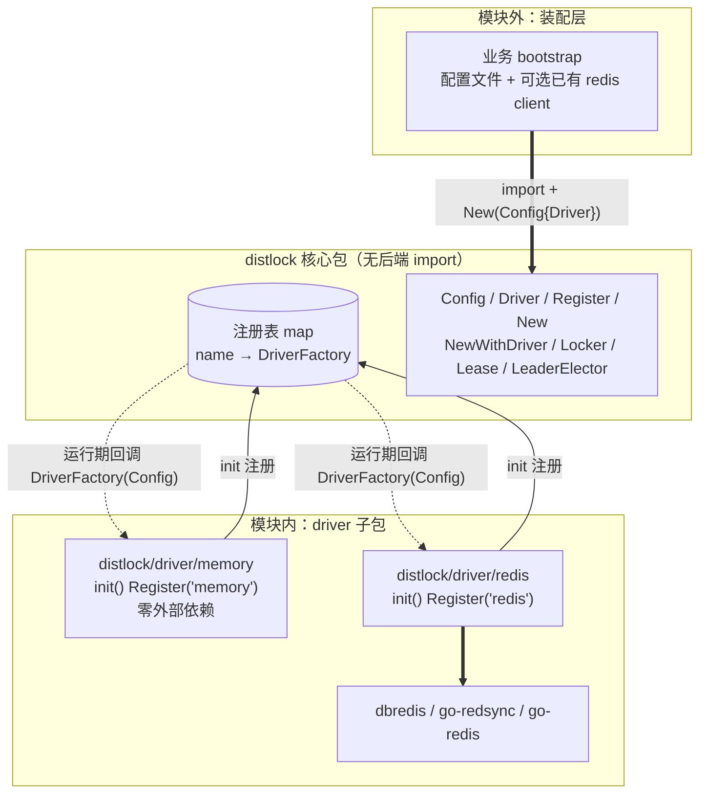
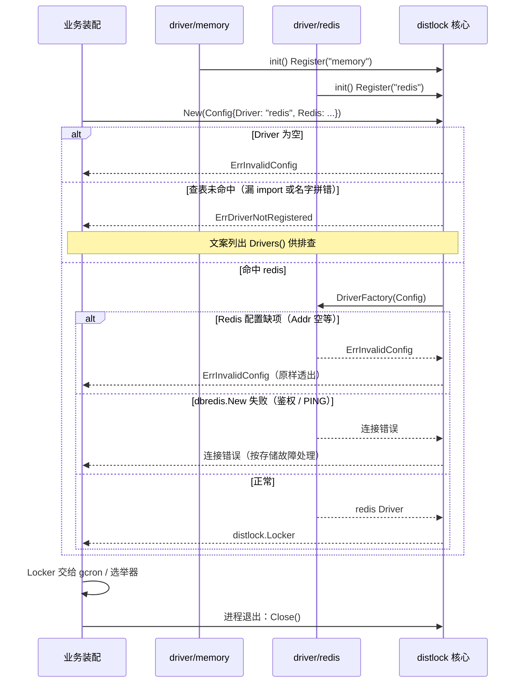

# distlock 后端注册表（driver 子包）改造方案

> 状态：已批准（2026-11-15，owner 确认接受新增子包与破坏性调整） ｜ 作者：NoHow ｜ 评审人：独立评审（调用方兼容 / 图与论证 两个 lens，记录在 `.dsh/docs/notes/review-*-distlock-driver-split.md`） ｜ 拍板人：NoHow（仓库 owner） ｜ 最后更新：2026-11-15
>
> 实施状态：M0–M5 已完成（**未提交**，待本地 review），实施记录见附录。

## 背景与目标

### 业务背景与现状

`distlock` 目前是**单包双形态**：`Locker` 通过包内非导出接口 `store`（`distlock/store.go:15-24`）接住两个实现 —— `redisStore`（`distlock/redis.go`）与 `inprocStore`（`distlock/mem.go`），对外只有 `NewRedis(rdb)` 与 `NewMemory()` 两个构造入口，分层见 `distlock/doc.go:20-33`。

两个入口按**部署形态二选一**：一个进程只装配一种后端 —— 要么进程内锁、要么 Redis 锁，不存在同进程同时使用两种后端（同一后端的多个 `Locker` 是允许的，`distlock/mem_test.go:11-25` 就是这种用法）。消费方 `task/gcron` 只持有 `*distlock.Locker`，见 `task/gcron/option.go:41-48`。

问题出在两个地方：

1. **依赖方向**。两个后端实现在同一个包内，Redis 实现的外部依赖因此成为核心包的传递依赖。实测（2026-11-15，`go list -deps ./distlock`）：传递包 204 个（含标准库），其中非标准库 22 个，21 个来自 go-redsync / go-redis 栈，1 个来自 google/uuid。直接 import 见 `distlock/redis.go:9-11`；版本见 `go.mod:25`（redsync v4.18.1）与 `go.mod:35`（go-redis v9.23.0）。
2. **装配方式与仓库其他数据访问组件不一致**。`gcache`、`storage`、`glog`、`gllm`、`dbaccess/dbgorm` 都是「核心包零后端依赖 + `driver/` 子包 + `init()` 注册 + 配置选后端」，只有 `distlock` 是"构造函数硬编码后端"。

### 痛点分析

1. **只用进程内锁的调用方被迫承担 Redis 栈**。CLI、单副本服务、只用 `NewMemory()` 的单元测试，只要 import `distlock`，就会把 21 个 Redis 栈第三方包带进构建图：编译它们、执行它们的包初始化。实测（2026-11-15，临时模块只 import `distlock` 并 `go mod tidy`）：

   | 观测对象 | 现状 | 拆分后预期 |
   |---|---|---|
   | 下游 `go.mod` 的 indirect requirement | 6 个（go-redsync、go-redis、xxhash、go.uber.org/atomic、golang.org/x/sys、google/uuid） | 1 个（google/uuid）`[假设]` |
   | 下游 `go.sum` 里 redsync / go-redis 的校验行 | 4 行（两个模块各 1 行 h1 + 1 行 go.mod） | 0 行 `[假设]`；同一文件里 `go-redis/redis` v6/v7/v8 等条目来自 `golib` 模块图的其他依赖，不受本次拆分影响 |
   | 下游 `go list -m all` 模块数 | 180 | 需拆分后实测 |
   | 编译/链接的第三方包 | 22 个非标准库包（含 uuid） | 1 个 |

2. **装配方式不可配置**。`storage` 用 `New(name, cfg)` 的第一个参数选 driver，`Config` 里不放假 driver 字段（`storage/registry.go:55`、`storage/config.go:17-18`）、`gcache` 用 `Config.Driver` + `Register` + `New(cfg)`（`gcache/registry.go:21,60`）、`dbgorm` 用 URL 前缀匹配 dialector（`dbaccess/dbgorm/dbgorm.go:122`）。三者共同点：**核心包不 import 任何后端，后端在子包里 `init()` 注册，装配层只写配置**。`distlock` 是唯一要调用方记住"哪个构造函数对应哪个后端"的组件，也多出两条无法统一校验的装配分支。

3. **上一版的否决理由需要逐条重判，且这次要把注册表纳入**。`docs/distlock-design-20261115.md:286`（备选 C）否决过"拆 `distlock/redis` 子包 + 公开端口"，三条理由是：① 用户明确要求单包；② 只有一个真实实现，端口是为假想需求预留；③ 消费方测试仍要靠实现。处理如下：

   | 上一版理由 | 本方案的态度 |
   |---|---|
   | ① 单包是用户要求（约束表「目录约定」：不接受 `distlock/` 下新增子包；`D11` 不改包路径；反目标① 把"引入公开端口/子包"记为失败） | **需要 owner 解除**。动机已从"后端可替换"变为"依赖隔离 + 装配一致"，但"公开面变大、多出子包"这条后果确实成立，必须由 owner 明确接受，见「待确认与开放问题」 |
   | ② 端口是为假想需求预留 | **不再成立**。依赖隔离不是假想需求：实测下游 `go.mod` 为只用内存形态付出 6 个 indirect requirement，`go.sum` 多出 redsync 与 go-redis 的 4 行校验（redsync 全仓只有 `distlock/redis.go:9-10` 一个 import 方） |
   | ③ 消费方测试仍要靠实现 | **部分成立**：拆分后 `driver/redis` 的测试仍用 miniredis，不比现状更差；核心测试改用导出的 `Driver` fake，仍然不接触真实 Redis |

   本轮新增的前提：注册表要**对齐 `gcache` 的写法，而不是 `dbgorm` 的 URL 匹配**——锁的后端选择是显式配置，不是"看连接串像什么"。

### 目标与非目标

**目标（技术目标）**

| 编号 | 目标 | 量化口径 |
|---|---|---|
| R1 | 只用进程内形态的调用方不再引入 Redis 栈 | 该路径下：非标准库传递依赖 22 → 1（google/uuid）；下游 `go.mod` 的 indirect requirement 6 → 1；下游 `go.sum` 里 redsync / go-redis 校验行 4 → 0（实测口径见「痛点分析」） |
| R2 | 核心包不 import 任何后端实现 | 核心的非标准库传递依赖**白名单只有 `google/uuid`**（用允许清单断言，不用黑名单前缀）；由入库脚本守护、review 记录 |
| R3 | `Locker` / `Lease` / `LeaderElector` 的对外行为与语义零变化 | 拆分前后各跑一次 `go test -json -race`，**测试名集合相等且无失败**（语义等价 oracle）；允许的源码改动白名单见「验证与验收」 |
| R4 | 装配方式与仓库其他数据访问组件一致 | `Config{Driver, Redis *RedisConfig}` + `Register` + `New(cfg)`；后端在 driver 子包 `init()` 注册；核心不含任何后端 import |
| R5 | 漏注册 / 配错后端有明确、可测的错误 | 未注册返回 `ErrDriverNotRegistered`（错误文案带 blank import 提示）；`Driver` 为空返回 `ErrInvalidConfig`；两者各有一条用例 |
| R6 | "二选一"语义显式化 | 一个进程只装配**一种后端**（同一后端的多个 `Locker` 是允许的，见 `distlock/mem_test.go:11-25`）；同 key 跨 `Driver` 互不互斥；`Driver` 必填、不默认内存形态。可执行判据：每个服务的**生产代码**（排除 `*_test.go` 与 `distlock/driver/**`）里 `distlock.New(` 的装配点恰好 1 处（`git grep` 计数） |
| R7 | 门面以接口暴露，消费者可注入 | `New` / `NewWithDriver` 返回 `Locker` 接口；`LeaderElector` 与 `gcron.WithLocker` 的入参都是接口；一条用例证明"注入 fake `Driver` 后不必起 Redis" |

**非目标（超出本期范畴）**

- 不新增后端（etcd / Postgres advisory lock / DB 行租约）。
- 不改锁协议、不改续期状态机、不改错误面。本期只移动实现位置、改装配方式。
- 不给 `distlock` 引入 key 前缀、默认 TTL 等新配置能力（`KeyPrefix` 在 `gcache` 有，这里明确不加：锁 key 由调用方拼，`distlock/doc.go:46-54` 的 ctx 契约也不动）。

**反目标（技术上达标但算失败的情形）**

- **下游迁移成本超过收益**：如果为了"核心零依赖"让每个调用方都得先补一行 blank import、再写一个 `Config` 字面量，而迁移表又没给全，v1.37 发布后出现"锁不生效/找不到后端"的求助——这算失败。
- **把编译期错误换成没人发现的运行期错误**：注册表让"漏 import"从编译失败变成启动期报错。如果错误文案不能一眼指出该 import 哪个包，或者没有一个测试守着这条路径，拆分就是把耦合换了个位置。

### 约束与非功能需求

- **破坏性变更窗口**：`distlock` 的公开 API 收敛尚未发版。`git describe` 为 `v1.36.2-2-g39dab3b8`，`CHANGELOG.md:3-26` 的整段破坏性重构都还在 `[Unreleased]` 的 v1.37 窗口内。本期改动应与该窗口**同批发布**；代价是 `CHANGELOG.md:7-9`、`distlock/README.md:130-147` 与根 README 的 v1.37 段必须随本方案**重写**（它们目前把 `NewRedis`/`NewMemory` 写成 v1.37 的新 API）。
- **上一版约束的现状**：`docs/distlock-design-20261115.md:72` 的「目录约定：不接受 `distlock/` 下新增子包」与 `D11`（不改包路径）在文档层面仍有效，本方案**要求解除**；owner 未接受前，本文只能算「请求变更约束」。
- **仓库没有 CI**：`git ls-files` 里不存在 `.github/`、`Makefile`、`Jenkinsfile`、`.gitlab-ci.yml`。任何"CI 守护"都是空头承诺，本方案改为**入库可执行脚本 + review 记录**。
- **技术栈**：Go 1.27（`go.mod:3`）；driver 子包只允许 import 核心包与各自的外部依赖（`driver/redis` 允许 `dbredis`、`redsync`、`go-redis`），不得反向依赖核心之外的其他仓库内部包。
- **预测性数字的收口**：「痛点分析」表"拆分后预期"列里的两个数字（indirect requirement 6 → 1、`go.sum` 校验行 4 → 0）是 `[假设]`，由 A2 的证伪实验负责收口；若实测不符，按 A2 的处置继续剥离依赖，而不是改文案。
- **无运行时非功能指标**：纯库结构改动，不涉及 QPS、延迟、容量（判据见「观察指标与判据」）。

### 验收标准

| 验收项 | 怎么验 | 谁验 | 阈值 |
|---|---|---|---|
| 行为不变 | 拆分前后各跑 `go test -json -race ./distlock/... ./task/gcron/`，比对测试名与结果 | 提交者 | 测试名集合相等、`fail` 数为 0 |
| 依赖边界 | 手工命令：先 `go build ./distlock`，再 `go list -deps -f '{{if not .Standard}}{{.ImportPath}}{{end}}' ./distlock` | 提交者执行并贴输出，review 记录 | 去掉自身后只剩 `google/uuid` |
| 装配契约 | 单测覆盖：`Driver` 为空、未注册名、`Driver=="redis"` 且 `Redis==nil`、重复 `Register`、`Drivers()` 排序、`NewWithDriver(nil)`；两个后端各一条 `Close` 幂等用例 + `Close` 后 `TryAcquire` 返回 `ErrClosed` | 提交者 | 9 条用例全绿，且错误可被 `errors.Is` 判定（核心 6 条不 import driver，写法照 `gcache/registry_test.go:58-96`） |
| 可注入性 | fake `Driver` + `NewWithDriver` + `NewLeaderElector`，运行一轮选举 | 提交者 | 用例通过，且该测试文件不 import 任何 driver |
| 下游视角 | 临时模块只 import `distlock` + `distlock/driver/memory`，`go mod tidy && go build` | 提交者 | 构建通过；`go.mod` 无 go-redsync / go-redis；`go.sum` 无任何 redsync / go-redis 行（与 R1 的 4 → 0 同口径） |
| 文档一致 | 对 M4 的显式文件清单执行 `git grep -n 'NewRedis(\|NewMemory(' -- distlock/doc.go distlock/README.md README.md README.zh.md task/README.md task/gcron/option.go task/gcron/cron_test.go` | 提交者 | 命中为 0（`CHANGELOG.md` 与 `docs/*design*.md` 按设计保留旧符号，不在扫描清单内） |

## 方案设计

### 系统上下文与边界

`distlock` 是库，没有独立部署单元；上下文只有三类角色：装配层（业务 bootstrap，持有配置文件，可能已有一个 redis client）、本组件（核心 + 两个 driver 子包）、消费方（`task/gcron`、外部使用者的业务代码）。

系统边界内：包布局、`Config` 与 `Driver` 契约、注册表行为、构造入口、文档与迁移表。系统边界外：redis client 的连接参数从哪来（配置文件或既有 `dbredis` 实例）、`task/gcron` 的锁使用方式、Redis 服务端拓扑。边界外这三项不随布局变化，本方案不对它们提要求。

### 总体思路

一句话：**把 `store` 接缝导出为 `Driver`，把两个后端搬到 `distlock/driver/{memory,redis}` 并在 `init()` 里 `Register`，核心改成 `Config{Driver, Redis *RedisConfig}` + `Register` + `New(cfg)` 的注册表装配；核心包从此不含任何后端 import。**

与上一轮草案的差别（也是本轮的核心修订）：不再用"两个强类型构造函数"表达二选一，而是用 **`Config.Driver` 配置 + 注册表查表**，与 `gcache`/`storage`/`dbgorm` 的装配方式对齐。

### 总体架构

图 1 是包结构与注册关系。三种边必须分开读，图例就写在图里：**粗实线 = import**（编译期依赖）、**细实线 = init 注册**（启动期往 map 里写）、**点线 = 运行期工厂回调**（核心调 driver 的 `DriverFactory`，不是 import）。注册表画在「distlock 核心包」子图内部，因为它是核心包内的一个 `map[string]DriverFactory`，不是独立包。**装配层对 driver 的 blank import 不画**：它是编译期依赖、且每个构建通常只 import 需要的那一个，画成第三条线会和"运行期回调"的点线混淆——这条约束放在 R6 的文字里说明。

它要回答的关切是：**核心包还看不看得到后端**，以及**注册表归谁所有**。选 Mermaid 的理由：6 个节点、单层包含关系、三种边用线型就能区分；换 SVG 只是换绘制器，不增加论据。



落着：**核心没有任何指向 driver 的 import**（图里从核心包出发的只有包内的注册表，指向 driver 的两条都是点线 = 运行期回调），这是 R2 与 R4 的可视化表述。Redis 栈与 `dbredis` 只挂在 `rds` 之下——**只 blank import memory 的构建图里看不到它们**（这是依赖隔离收益的图形表述）。没画出来的 blank import 带来一个编译期事实：允许同时 import 两个 driver，两个工厂都会被注册；**运行期选哪个由 `Config.Driver` 决定，而"一个进程只用一种后端"是装配层约定、不是机制**——图上的虚线表达不了这条约定，正文把它落在 R6 与沉默清单第 1 条。

### 核心流程

图 2 是"从配置到 Locker"的时序，含四类失败。它要回答的关切是：**`Driver` 为空、漏 blank import、后端名拼错、Redis 配置缺失/连不上，分别在哪一步、以什么错误暴露**。



落着：四类失败的归属不同——`Driver` 为空、配置缺项都是 `ErrInvalidConfig`（配置错误，不要重试）；查表未命中是 `ErrDriverNotRegistered`，文案给出 `Drivers()` 列表，**不指向一个拼错名字对应的、不存在的子包路径**；`dbredis.New` 的失败（鉴权、PING）原样透出，按存储故障处理。图里**没有覆盖**的两件事，写在这里：`NewWithDriver`（测试与 fake `Driver` 注入）与 `Close`（进程退出时释放 driver 自建的 client）；以及"一个进程只用一种后端"的约定——后者没有机制，只能靠 review：可执行判据是生产代码里 `distlock.New(` 的装配点每个服务恰好 1 处（测试与 driver 包不计）。

### 备选方案与取舍

| 备选 | 做法 | 代价 | 结论 |
|---|---|---|---|
| **A 不做（维持单包）** | 只补文档，说明"只用内存形态也会带 Redis 依赖" | 21 个 Redis 栈包永久留在只用内存的调用方构建图里；`distlock` 继续是仓库里唯一的装配例外 | 否决：痛点不解决，且仓库已有五个同类先例 |
| **B 拆两个 driver 子包 + 强类型构造，不建注册表（上一轮草案）** | 核心导出 `Driver` 与 `NewWithDriver`；两个 driver 子包各自暴露 `New(...)` 直接返回 `*Locker`；没有 `Config` / `Register` / 注册表 | 依赖问题能解，但装配方式仍与 `storage`/`gcache`/`dbgorm` 不一致；调用方要记住"哪个构造函数配哪个后端"，配置里无法表达；**同样要新增子包**，所以它不能作为"owner 不解除子包约束"时的兜底 | 降级为候选：仅当 owner 接受新增子包、但拒绝注册表带来的公开面与运行期错误时选它 |
| **C 注册表 + driver 子包（本方案）** | 核心 `Config{Driver, Redis *RedisConfig}` + `Register` + `New(cfg)`；两个 driver `init()` 注册 | 公开面净增 7 个符号（新增 9 个：`Driver`、`DriverFactory`、`Config`、`RedisConfig`、`Register`、`Backends`、`New`、`NewWithDriver`、`ErrClosed`；删除 2 个：`NewRedis`、`NewMemory`）+ 两个新子包；漏 import 从编译期错误变启动期错误 | **采纳**：与仓库数据访问组件一致，装配可配置，且靠错误文案与用例兜住运行期风险 |
| **D 两个独立包各自完整实现 `Locker`/`Lease`** | `distlock/mem` 与 `distlock/redis` 各带一份租约状态机 | 续期状态机两份、漂移风险高；`LeaderElector` 无处安放 | 否决：上一版 `Factory`/`Mutex` 就是对象模型外泄的教训（`docs/distlock-design-20261115.md:40,162`） |
| **F 门面维持 `*Locker` 具体类型** | 只拆后端，不动门面 | 与仓库其余组件（`Cache`/`Storage`/`Logger`/`Limiter` 全是接口）不一致；`locker` 以后加方法都要走公开面评估 | 降级为候选：接口化的收益在可注入与演进自由度，成本只有 1 个符号（`Locker` 原本就导出，只是 struct → interface） |
| **G `Lease` 也接口化（新增 `Lock` 接口）** | `TryAcquire` 返回 `Lock` 接口，消费者可完全 mock | 名字撞 v1.36.2 已删除的 `Lock`；7 个方法钉死后，`Resign`/`Holder` 等演进都变破坏性；fake 更容易偏离真实丢锁语义 | 否决：理由见「接口设计」设计要点第二条 |
| **E 用构建标签（build tag）二选一** | `//go:build redis` / `!redis` 各编一份 | 同一 module 无法给下游提供一致的 API；标签组合矩阵爆炸；`go test ./...` 需带标签 | 否决：把"运行期配置"换成"编译期开关"，比注册表更难用 |

### 技术选型与理由

**① 接缝接口的名字：`Driver`**（终局口径，忽略改名成本）。评估维度：**与方法的读法是否自洽**、**整套词汇是否只剩一个词**、主流先例、旧语义包袱。

| 候选 | 与方法连读 | 词汇一致性 | 主流先例 | 结论 |
|---|---|---|---|---|
| `Driver` | 是：`driver.Acquire/Renew/Release` 读作"driver 执行获取/续期/释放" | **完整**：`Config.Driver` 选 → `distlock.Driver` 实现 → `driver/` 目录放 → `Drivers()` 列出 | 强：`database/sql` 的"注册 driver、按名选择"就是本包机制的原型；`gocloud.dev` 的 driver 包同样以 driver 命名后端实现；本仓 `storage`（`DriverType` / `Drivers()`）、`glog/driver`、`gllm/driver`、`dbgorm/driver` 共四处同构 | **采纳** |
| `Mutex` | 是：`mutex.Acquire` 最贴切 | 中 | 中：`redsync.Mutex`、`etcd concurrency.Mutex` 都是**单把锁对象**，而本接口按 key 操作、是"多锁管理器"，结构上不匹配 | 否决（语义错位 + 旧接口同名） |
| `Store` | **否**：`store.Acquire(...)` 是"容器名词 + 动作动词"的错配 | 中 | 弱：`storage.Storage`/`Cache`/`Logger` 的方法都是容器动词（`Get`/`Put`/`Info`），锁动词不成立 | 否决（初版曾采用） |
| `Backend` | 是：`backend.Acquire(...)` | **不完整**：`Config.Backend` 与 `driver/` 目录是同一个概念的两个名字 | 中：`hashicorp/vault` 的 `physical.Backend`、本仓 `gcache.Config.Backend` | 否决（中间版本，已改名为 `Driver`） |

演进记录（终局前的两版，保留以便回溯）：初版用 `Store`（对齐仓库容器型门面），评审发现"容器名词 + 动作动词"错配；第二版用 `Backend`（动作执行者名词），评审按终局口径指出词汇不统一（`Config.Backend` 与 `driver/` 目录是同一个概念的两个名字）；最终统一为 `Driver`。早先"`Driver` 在说插件机制而不是被抽象的东西"这条否决理由，在终局口径下被推翻：本接口的**唯一实现者就是 driver**，一套词汇带来的可维护性高于这层命名直觉。

工厂类型名不叫裸 `Factory`：v1.36.2 的 `distlock.Factory` 是接口（`NewMutex(key, ttl) (Mutex, error)`），v1.37 已在 `CHANGELOG.md:7` 承诺删除它；同一版本里"删 `Factory` 又新增 `Factory`"会让迁移读者误解。用 `DriverFactory`，与 `storage.StorageFactory`（`storage/registry.go:8`）同形。

**② 注册表 vs 强类型构造**：注册表换来的是一致性（R4）与可配置装配，代价是把"漏 import"从编译期错误变成启动期错误。这里接受代价，因为仓库里 `gcache` 走的是同一条路。错误文案**有意不照抄** `gcache/registry.go:77-79` 的拼接式写法（它用后端名拼出 `gcache/<name>` 路径，名字拼错时路径并不存在）：`distlock` 的子包都在 `driver/` 下，文案改为列出当前 `Drivers()` 并提示"记得 blank import 对应 driver 子包"。**不接受 `dbgorm` 那种"按 URL 前缀自动匹配"**：锁的后端选择必须是显式配置，不能靠连接串猜。

**③ client 怎么来：只留配置路径，不做注入**（终局决策，判据见下）。`driver/redis` 用 `dbredis.New` 从 `Config.Redis`（纯数据）自建 client，与 `gcache/redis`（`gcache/redis/redis.go:30-51`）完全同构；`distlock` 不再接受外部 `client` 参数。

终局判据按重要性排序：

| 判据 | 单一配置路径 | 双路径（配置 + 注入） |
|---|---|---|
| 正确构造方式的数量 | 1 | 2，每次装配都要做判断题；混用风险进沉默清单 |
| 与仓库惯例一致 | 高：`gcache`/`dbgorm` 都自建连接，没有任何组件接受注入 client | 低：`distlock` 又成孤例 |
| 连接生命周期 | driver 拥有 → 由 `Locker.Close()` 收口 | 半：driver 建的 client 没人关，注入的 client 归调用方 |
| 已有 pool 复用 | 不支持，多一个 pool（锁的流量很小，1–2 条连接足够） | 支持 |
| cluster / sentinel / TLS | 不支持（`dbredis.New` 只返回单节点 `*redis.Client`） | 支持（`UniversalClient`） |
| 配置来源 | 与 `dbredis` 各写一份（有漂移风险） | 复用同一 client，无漂移 |
| 测试可注入性 | 由 `fake Driver` + `NewWithDriver` 满足 | 由注入满足 |

结论：**取单一配置路径**。理由是前三条（一个正确答案、仓库惯例、生命周期收口）是终局属性，而后三条都是可以单独解决的问题——pool 多一个的代价是 1–2 条连接；cluster/TLS 要靠"扩 `RedisConfig` 字段"这条纯加法路径解决（列入已知未覆盖），而不是靠在构造层留旁路；配置漂移靠"同一份 YAML 块 + 部署 checklist"约束（见沉默清单第 6 条）。**什么情况下应该翻回双路径**：如果近期就要求锁必须复用业务侧那一个 client（例如集群拓扑、或统一鉴权/审计），那时再加注入入口，并把它明确标成 escape hatch；在那之前，留旁路只会让"用哪个"变成长期判断题。

**④ `Driver` 必填、不默认 `memory`**：`gcache` 的 `Config.Driver` 空值时默认 `memory`（`gcache/registry.go:109-121`）。`distlock` 不照抄这条默认：锁误配成内存形态在多副本下**静默失去互斥**，代价远高于缓存误配；空值直接 `ErrInvalidConfig`，强迫装配层显式写清。

**代价汇总**：核心公开面净增 7 个符号（新增 `Driver`、`DriverFactory`、`Config`、`RedisConfig`、`Register`、`Backends`、`New`、`NewWithDriver`、`ErrClosed` 共 9 个，删除 `NewRedis`、`NewMemory` 共 2 个），外加 2 个子包；启动期多一次查表（常数级）；调用方多一行 blank import 与一份 `Config`。另有四项容易被忽略的代价：

- **`RedisConfig` 与 `dbredis.RedisConfig` 字段重复**（7 个字段一一对应，见 `dbaccess/dbredis/config.go:9-22`）：多一份要同步的配置结构，这是"核心不引入 dbredis 类型"的代价；两份配置漂移的风险见沉默清单第 6 条。
- **多一个连接池**：锁与业务各用一条连接池（各 1–2 条连接即可）。换来的是"锁的 Redis 归属明确写在 distlock 自己的配置块里"。
- **能力收窄**：`dbredis.New` 只返回单节点 `*redis.Client`（`dbaccess/dbredis/client.go:12`），而现状 `NewRedis` 接受 `UniversalClient`（`distlock/redis.go:37`）。cluster / sentinel / 自定义 TLS 本期不支持，扩 `RedisConfig` 是后续纯加法路径（见「已知未覆盖」）。
- **构造期有副作用**：`dbredis.New` 会立即 PING 并打印连接结果（`dbaccess/dbredis/client.go:65-71`），且依赖 `glog` 已初始化（`client.go:17`）。`New` 因此不是纯函数，"装配期构造一次、不要每把锁建一个 Locker"写进文档。

### 决策与需求对照

| 决策 | 承接需求 | 备选（含不做） | 验证手段 | 状态 |
|---|---|---|---|---|
| D1 拆出 `distlock/driver/{memory,redis}`，核心零后端 import | R1、R2 | A（不做）/ B（只拆 redis） | `go list -deps` 允许清单复核 + 下游临时模块构建 | Accepted |
| D2 核心导出 `Driver` 三方法接口，`store` 改名导出 | R2、R4 | `Mutex` / `Driver` 命名 | `go doc ./distlock` 导出清单 | Accepted |
| D3 采用注册表：`Config{Driver, Redis}` + `Register` + `New(cfg)` | R4、R5 | B（强类型构造）/ E（build tag）/ `dbgorm` 式 URL 匹配 | 装配契约 6 条用例 | Accepted |
| D4 未注册与空 `Driver` 分别返回 `ErrDriverNotRegistered` / `ErrInvalidConfig` | R5 | 统一返回一个错误（调用方无法区分"漏 import"与"配错"） | 两条 `errors.Is` 用例 + 错误文案断言 | Accepted |
| D5 redis 只保留配置路径：driver 用 `dbredis.New` 自建 client，不做 client 注入 | R3、R4 | 双路径（配置 + 注入，支持复用 pool 与 cluster） | miniredis 端到端用例（`Config{Driver:"redis"}`）+ 依赖边界脚本 | Accepted |
| D10 driver 拥有 client → `Locker` 提供 `Close() error`（memory 空实现、幂等） | R3、R4 | 不提供 Close（client 与进程同生命周期，测试里会叠连接池） | `Close` 幂等用例（两个后端各一条）+ `New` 后不 `Close` 的 goroutine 泄漏检查 | Accepted |
| D6 `Driver` 必填、不默认 memory | R5、R6 | 照抄 `gcache` 默认 memory | 空 `Driver` 用例 | Accepted |
| D7 `LeaderElector`、`Hooks`、`Option`、错误面留在核心，签名不变 | R3 | 跟随 driver 拆分 | 选举与 `Hooks` 用例不改断言全绿 | Accepted |
| D8 与 v1.37 破坏性窗口同批发布，`CHANGELOG` v1.37 段重写为唯一迁移表 | R3、R4 | 单独发 v1.38 | `CHANGELOG.md` 版本段核对 | Accepted |
| D9 `Locker` 改为接口、实现非导出；`Lease` 保持具体类型、不定义 `Lock` 接口 | R3、R7 | F（维持 `*Locker` 具体类型）/ G（`Lease` 也接口化） | `go doc ./distlock` 清单 + "fake `Driver` → `NewWithDriver` → 注入 `LeaderElector`"用例 | Accepted |

## 详细设计

### 模块划分与职责

```text
distlock/                     核心：Config、RedisConfig、Driver、DriverFactory、Register、Backends、New、NewWithDriver、
                              Locker、Lease、LeaderElector、Hooks、Option、错误
distlock/driver/memory/       inprocStore（共享占用表）、init() 注册 "memory"
distlock/driver/redis/        redisStore（redsync 适配）、init() 注册 "redis"、用 dbredis.New 自建 client
```

职责与今天完全一致，只换位置：`driver/redis` 不重试、不记日志（`distlock/redis.go:58-70` 的现状不变）；`driver/memory` 沿用包级共享占用表（`distlock/mem.go:36-37`），同进程内所有内存形态门面仍互斥。核心新增的只有装配代码（Config/注册表/New），不含任何锁逻辑。

### 接口设计

```go
// distlock（核心，零后端依赖）
type Driver interface {
    Acquire(ctx context.Context, key, token string, ttl time.Duration) error
    Renew(ctx context.Context, key, token string, ttl time.Duration) error
    Release(ctx context.Context, key, token string) error
}

type DriverFactory func(Config) (Driver, error)

type Config struct {
    Driver string       // 必填："memory" | "redis"
    Redis   *RedisConfig // Driver="redis" 时必填
}

type RedisConfig struct { // 纯数据，不引入 dbredis 类型
    Service      string // 空则由 driver 填 "distlock"（dbredis.New 要求非空）
    Addr         string
    Password     string
    DB           int
    DialTimeout  time.Duration
    ReadTimeout  time.Duration
    WriteTimeout time.Duration
}

func Register(name string, f DriverFactory)     // 空名 / nil / 重复注册 → panic（与 gcache 一致）
func Drivers() []string
func New(cfg Config, opts ...Option) (Locker, error)
func NewWithDriver(s Driver, opts ...Option) (Locker, error) // nil → ErrInvalidConfig；测试与自定义 Driver 用

// Locker 是面向调用方的门面（接口，不是结构体）。实现是非导出的 locker。
type Locker interface {
    TryAcquire(ctx context.Context, key string, ttl time.Duration) (*Lease, error)
    Acquire(ctx context.Context, key string, ttl time.Duration) (*Lease, error)
    Close() error // 释放 driver 自建的连接资源；memory 空实现；幂等；Close 后 TryAcquire 返回 ErrClosed
}

// Lease 仍是具体类型：它是唯一的时间权威，方法集（Key/Token/TTL/Context/Lost/Cause/Release）
// 随能力演进以"纯加法"方式扩展，不做接口化。
```

```go
// distlock/driver/memory
func init() { distlock.Register("memory", newBackend) }

// distlock/driver/redis
func init() { distlock.Register("redis", newBackend) } // newBackend 内部用 dbredis.New 建 client，Driver 持有它
```

设计要点：

- `Driver` 的三条契约原样搬到导出注释（单次尝试不内部重试 / 未持有与被占用一律 `ErrLocked` / 必须尊重 `ctx`），并写明"续期丢锁判定依赖第三条"，避免实现者只读签名。
- `Register` 的 panic 语义对齐 `gcache/registry.go:21-34`、`storage/registry.go:20-33`：空名、nil 工厂、重复注册都是编程错误，启动期就炸。
- `New` 的顺序固定：校验 `Config`（含 `Driver` 为空、`Driver=="redis" && Redis==nil`）→ 查表 → `DriverFactory(cfg)` → `newLocker(store, opts)`。
- 分工固定：**driver 负责"`Config` → `Driver`（含 client）"，核心负责"`Driver` → `Locker`"**。`NewWithDriver` 是这条分工的另一半，也是包内测试与外部使用者的注入点（fake `Driver` → 真实 `Lease` 语义）。
- **连接归 driver 所有**：`driver/redis` 的 `Driver` 持有一个由 `dbredis.New` 建出来的 client，因此 `Locker.Close()` 负责关闭它；`driver/memory` 的 `Close` 是空实现。`Close` 幂等，重复调用返回 nil。装配层约定：一个进程一个 `Locker`，进程退出时 `Close`，不要每把锁建一个（`New` 有 PING 副作用，且会叠连接池）。
- **`Option` 只作用于 Locker**（`Hooks`、`RetryInterval`），不能用来选后端或提供 `Redis` 配置：`Driver` / `Redis` 只能来自 `Config`。这与 `gcache` 的 `New(cfg, opts...)`（其 opts 能覆盖 `Driver`、`WithRedis` 会顺带改 `Driver`）**有意不同**——distlock 的 Option 是门面级观测配置，不是配置覆盖层；否则 `New(Config{}, WithHooks(...))` 会让人误以为存在默认后端。
- **`Driver=="redis" && Redis==nil` 的校验放在核心**（与 `gcache/registry.go:132-134` 同位置），所以核心包内不 import driver 就能覆盖这条分支；driver 工厂内保留防御性检查（`Addr` 为空等），但不再承担"缺 `RedisConfig`"的主判定。
- **注册表用 `sync.RWMutex`，`Drivers()` 返回字典序排序结果**（实现骨架照抄 `gcache/registry.go:12-54`），否则运行期 `Register`（测试或第三方）会 data race，且返回 map 随机序会让用例 flaky。
- **`Close` 的语义**：`Close` 之后 `TryAcquire` / `Acquire` 返回新增的哨兵 `ErrClosed`（`errors.Is` 可判），`Close` 本身幂等、重复调用返回 nil；已持有的 `Lease` 不受影响，仍需调用方 `Release`。续期用的是 `Driver`，所以 `Close` 只负责关 client——文档写死顺序「先 `Release` 所有租约，再 `Close`」，否则会出现「关掉连接后续期失败、判丢锁」的噪音。
- **门面接口化**：`Locker` 从结构体改为接口，实现是非导出的 `locker`（结构体）。理由是与 `gcache.Cache`、`storage.Storage`、`glog.Logger`、`ratelimit.Limiter` 一致——仓库里所有消费门面都是接口，只有 `distlock` 是具体类型。副作用是好的：`locker` 以后加方法不算破坏性变更，接口只要守住 2 个方法即可。
- **不定义 `Lock` 接口（即不给 `Lease` 做接口）**，三条理由：① 名字撞车——v1.36.2 就有 `distlock.Lock` 接口（`TryLock/Refresh/Unlock/Token`），v1.37 已承诺删除，再引入同名不同义正是上一轮修掉的 `Factory` 问题；② `Lease` 是唯一的时间权威，把 7 个方法钉在接口上，以后加 `Resign`/`Holder` 这类能力就成了破坏性变更，违背上一版定的"纯加法演进"；③ 消费者要 fake 时不需要 `Lock`——实现一个 fake `Driver` 交给 `NewWithDriver`，就能拿到**真实的** `*Lease` 语义（含丢锁通知），比手搓假对象更可信。
- **`LeaderElector` 的入参同步改成 `Locker` 接口**（原 `*Locker`）：这是破坏性变更，但正好在 v1.37 窗口内；改完之后选举器可以注入 fake（fake `Driver` + `NewWithDriver`），测试不必起 Redis。
- 包名遵循 `gcache/redis` 的先例叫 `redis`（不是 `redislock`）。装配层通常只需 blank import（`_ "github.com/morehao/golib/distlock/driver/redis"`），因此不存在与 `github.com/redis/go-redis/v9` 的 `redis` 撞名问题；只有 `driver/redis` 自己的测试需要同时引两者，按 `goredis "github.com/redis/go-redis/v9"` 起别名。

### 迁移对照（旧 → 新）

拆成两张表，因为落地时存在两个不同的"旧"：**已发布的 v1.36.2**，和**本分支尚未发版的 v1.37 中间态**。`CHANGELOG` 只用主表（外部用户只会从 v1.36.2 跳过来）；副表只服务本分支的代码迁移。

**主表：v1.36.2（已发布，`git show v1.36.2:distlock`）→ v1.37 终态**

| v1.36.2 的用法 | v1.37 终态 | 迁移性质 |
|---|---|---|
| `distlock.New(f)` + 自定义 `Factory`（`NewMutex(key, ttl)`） | 自定义后端改为实现 `distlock.Driver`（三方法）并 `Register("name", 工厂)`；装配层用 `New(Config{Driver:"name"})` | **重写**，不是一行替换 |
| `distlock.NewRedisFactory(clients...)` + `New(f)` | `distlock.New(Config{Driver:"redis", Redis:&RedisConfig{...}})` + blank import `driver/redis` | **换装配方式**：把原来传给 client 的连接信息写进 `RedisConfig`（7 个字段，对齐 `dbredis.RedisConfig`） |
| `distlock.NewRedis(clients...)`（多节点 quorum） | 不再支持多节点；只有单节点 `RedisConfig` | 能力移除（`CHANGELOG` v1.37 段已声明） |
| `Mutex` 接口（`TryLock/Refresh/Unlock/Token`）、`AcquireOption`、per-call `WithHooks` / `WithRenew*` | 删除；语义合并进 `Driver` / `Locker` / 构造期 `Option` | 删除（`CHANGELOG` v1.37 段已声明） |
| `MinTTL=200ms`；`ErrInvalidKey` / `ErrInvalidTTL` / `ErrInvalidOption` / `ErrNilFactory` | `MinTTL=1s`；`ErrInvalidConfig`；新增 `ErrDriverNotRegistered` | 合并 / 新增 |
| `*distlock.Locker`（具体结构体）、`NewLeaderElector(locker *Locker, ...)`、`gcron.WithLocker(*Locker)` | `distlock.Locker` 改为**接口**（方法不变，仅类型 kind 变化）；`NewLeaderElector` / `WithLocker` 入参同步改为接口 | 类型替换，调用点通常 1 行；`nil` 判断语义不变 |
| `Lease`、`TryAcquire` / `Acquire` 的签名与行为、`LeaderConfig`、`Callbacks` | 不变（`TryAcquire` 仍返回 `*Lease`） | 无需改动 |

更早的 `LockFactory` / `NewDistLock` / `Config{Key,TTL,AutoRenewal}`（≤v1.35.x）在 v1.36.x 已经移除，本文不覆盖那一跳。

**副表：本分支的 v1.37 中间态（未发版）→ 终态**

| 中间态 | 终态 | 说明 |
|---|---|---|
| `distlock.NewRedis(rdb)` | `distlock.New(Config{Driver:"redis", Redis:&RedisConfig{...}})` + blank import `driver/redis` | 中间态从未发布，外部用户不会遇到 |
| `distlock.NewMemory()` | `distlock.New(Config{Driver:"memory"})` + blank import `driver/memory` | 同上 |
| 包内非导出 `store` 与测试 `fakeStore` | 导出 `distlock.Driver`；新增 `NewWithDriver` | 只影响本仓测试与 driver 包 |

```go
// 主表最常走的一条：v1.36.2 → v1.37
// 旧
locker, err := distlock.New(distlock.NewRedisFactory(rdb)) // 或 distlock.NewRedis(rdb)（多节点）
// 新：把 redis 连接信息写进 distlock 自己的配置块
locker, err := distlock.New(distlock.Config{
    Driver: "redis",
    Redis:   &distlock.RedisConfig{Service: "order-svc", Addr: "10.0.0.8:6379", Password: "***", DB: 0},
})
defer locker.Close() // driver 拥有连接，退出时关闭

// 副表（本分支中间态 → 终态）
locker, err := distlock.NewRedis(rdb) // 改成上面的 Config 写法
locker := distlock.NewMemory()        // 改成 distlock.New(distlock.Config{Driver: "memory"}) + blank import driver/memory
```

迁移代价的量化口径：生产代码 0 处（`task/gcron` 只把 `*distlock.Locker` 换成 `distlock.Locker` 接口，1 行）；测试与示例 9 处（实测 `grep -rn 'NewRedis(\|NewMemory(' --include=*.go distlock task`，排除注释后为 9）；文档 5 个：`distlock/doc.go`、`distlock/README.md`、根 `README.md`、`README.zh.md`、`task/README.md`（另加 `CHANGELOG.md` 与旧设计文档的取代说明）。对外部用户而言，重写成本集中在主表第一行（自定义 `Factory` 的使用者），单纯用 Redis 的调用方是"一行替换 + 一个 import"。

### 关键逻辑与算法

本期**不新增锁逻辑**。核心新增的只有装配代码（`Config` 校验、查表、`DriverFactory` 调用），不含时间预算与状态机；`git diff -M` 应显示 `redis.go`/`mem.go` 以重命名方式进入 driver 包，而不是新写实现。

需要移动的只有三类代码，逐条列清避免"顺手重构"：

- 后端原语：`redisStore` 的 `acquire`/`renew`/`release`（`distlock/redis.go:58-70`）与 `inprocStore` 的同名三方法（`distlock/mem.go:39-66`）。
- 后端专属辅助：`normalizeRedisOutcome` / `isHeldErr`（`distlock/redis.go:76-111`）与两个 Redis 常量（`distlock/redis.go:18-22`），随 Redis driver 走。
- 进程内共享占用表 `sharedInproc`（`distlock/mem.go:36-37`），随内存 driver 走。

留在核心且逻辑一行不改的：续期循环 `renewLoop`（`distlock/lease.go:204-250`）、时间预算 `timingFor`（`distlock/lease.go:31-39`）、`Release` 的幂等与有界等待（`distlock/lease.go:138-174`）、选举器（`distlock/election.go`）、`Hooks` 派发（`distlock/options.go:85-115`）。

## 验证与验收

### 验证手段

1. **行为基线（先做）**：改动前记录 `go test ./distlock/... ./task/gcron/ -race` 全绿作为基线；基线用例覆盖慢续期不误杀、窗口耗尽判丢、并发 `Release` 同结果、`Hooks` panic 隔离、miniredis 端到端（`distlock/teststore_test.go` 的 fake + `distlock/redis_test.go`）。
2. **等价性验证（oracle，不是"断言行 0 改动"）**：拆分**必然**要改测试里的标识符——测试搬进子包后核心符号要加 `distlock.` 限定（`MinTTL`、`ErrLocked`、`ErrLockLost` 等），fake 要实现导出的 `Driver`（方法首字母大写），构造调用要换成 `New(Config)`。判据分两条：
   - **允许改动白名单**：`package` 子句、import 行（含包名/别名）、构造调用、标识符加 `distlock.` 限定、测试 fake 的方法名首字母大写、`newTestLocker` 一类辅助的类型名、**测试函数改名（必须附旧→新映射）**。**断言与期望值不在白名单内**。
   - **语义 oracle**：拆分前后各跑一次 `go test -json -race ./distlock/... ./task/gcron/`，把测试全名去掉包路径前缀后排序 diff（包名变化不算差异），要求测试名集合相等、`fail` 为 0；改名按白名单里的映射换算后再比。`git diff -M --stat` 只用来证明"文件是搬的不是重写"。
   - **测试文件的落点**（避免 import cycle）：`mem_test.go` 迁到 `distlock/driver/memory`（测试名保留）；`redis_test.go` 与它的 miniredis helper 迁到 `distlock/driver/redis`；`example_test.go` 改成 `package distlock_test` 或随用例迁入 driver 包；核心的 fake `Driver` 用例留在 `package distlock` 内，继续用包内 `newLocker` / `NewWithDriver`。`package distlock` 的测试**不能** blank import driver（driver import 核心，构成循环）。
3. **依赖边界复核**（review 时手工执行，不入库脚本）：先 `go build ./distlock`（否则包编译不过时 `go list -deps` 输出为空、断言会假通过），再用**允许清单**判断——`go list -deps -f '{{if not .Standard}}{{.ImportPath}}{{end}}' ./distlock` 去掉自身后，只允许 `github.com/google/uuid`。前缀黑名单不够：实测 21 个包里只有 18 个命中 `go-redsync|go-redis`，`cespare/xxhash`、`go.uber.org/atomic`、`golang.org/x/sys/cpu` 会漏。
4. **装配契约用例**：`Driver` 为空 → `ErrInvalidConfig`；`"bogus"` → `ErrDriverNotRegistered`，且文案列出 `Drivers()` 的当前内容（**不拼一个不存在的子包路径**）；`Driver:"redis"` 且 `Redis==nil` 或 `Addr` 为空 → `ErrInvalidConfig`；重复 `Register` → panic；`Drivers()` 在两个 driver 都被 import 时含 `memory`、`redis`；`NewWithDriver(nil)` → `ErrInvalidConfig`。
5. **可注入性用例（R7）**：在核心包内实现一个 fake `Driver`，`NewWithDriver(fake)` 拿到 `Locker`，注入 `NewLeaderElector` 并跑一轮选举——全程不启动 Redis、不 import driver。这条用例同时证明"接口化"的收益与"fake 能拿到真实 `Lease` 语义"（含丢锁通知）。
6. **下游视角**：临时模块只 import `distlock` + `distlock/driver/memory`，`go mod tidy` 后查 `go.mod`/`go.sum`，再 `go build`。这是 R1 的直接证据，也是唯一能证明"下游真的不再被拖入"的方式（现状基线已实测）。
7. **文档一致性**：`go doc ./distlock` 清单与新接口逐项对齐；旧构造扫描走 M4 的显式文件清单（7 个文件）——`CHANGELOG.md` 与 `docs/*design*.md` **按设计**保留旧符号，全仓无排除的 grep 永远不可能归零（全仓命中里包含 `CHANGELOG.md` 与 `docs/*design*.md` 的迁移段、以及 `task/gcron/option.go:43-44` 这类注释：前者按设计保留，后者已列入 M4 清单）。

### 关键假设与证伪实验

| 假设 | 证伪实验 | 若被证伪 |
|---|---|---|
| A1 现有用例足以覆盖行为基线（无未测路径） | 改动前对照 `distlock/*_test.go` 用例清单，逐条映射到 `distlock/README.md` 的「语义」表 | 先补基线用例再做拆分 |
| A2 拆分后下游 `go.mod` 的 Redis 栈 indirect requirement（现状 6 个）与 `go.sum` 校验行（现状 4 行）都归零 | 临时模块 `go mod tidy` 后读 `go.mod` / `go.sum` | 若仍出现，说明依赖来自核心的其他 import 或 `distlock` 的测试依赖，继续剥离 |
| A3 下游 `go list -m all` 仍会列出 go-redsync/go-redis 等模块条目（它们是 `golib` 模块图的成员），不随子包拆分消失 | 同上临时模块执行 `go list -m all` | 若 owner 认为模块图条目也算"依赖未解耦"，则需把 Redis driver 拆成独立 module（本期不做） |
| A4 仓库确实没有可挂载的 CI | `git ls-files` 里找不到 `.github/`、`Makefile`、`Jenkinsfile`、`.gitlab-ci.yml` | 若有外部流水线，把「验证手段」#3 的 `go list -deps` 命令挂上去即可，判据不变 |

### 观察指标与判据

本改动无运行时指标（不涉及请求路径、延迟、容量），不接监控面板，改用两条可查证据：入库脚本的依赖断言（任何机器可复跑），以及发布后的迁移质量判据。

发布后观察期为 v1.37 发布起 14 天（口径：从 v1.37 tag 推送到第 14 天；数据源：仓库 issue 全量，关键词 `distlock` / `blank import` / `backend not registered`），判据：与"锁不生效 / 找不到后端 / 漏 blank import"相关的 issue 为 0。出现即视为迁移表或错误文案不合格，处置是补 `CHANGELOG` 示例与 `ErrDriverNotRegistered` 文案，**不回滚结构**——结构本身没有运行时风险。

## 实施计划

### 阶段与里程碑

| 阶段 | 内容 | 通过判据 |
|---|---|---|
| M0 基线 | 记录测试基线，确认无未提交改动 | 基线全绿 |
| M1 核心装配层 | `store` → 导出 `Driver`；新增 `Config` / `RedisConfig` / `DriverFactory` / `Register` / `Backends` / `New(cfg)` / `NewWithDriver`；`Locker` 结构体改为接口 + 非导出 `locker`；`Lease` 改用 `Driver`；`LeaderElector` 入参改接口 | 核心包可编译；装配契约用例（空 Driver、未注册、`NewWithDriver(nil)`）先红后绿 |
| M2 driver 落地 | 新建 `driver/memory`（`init` 注册 + 搬 `inprocStore` + `Close` 空实现）与 `driver/redis`（`init` 注册 + 搬 redsync 适配 + 用 `dbredis.New` 建 client + `Close` 关 client） | 两个包各自测试全绿；`:memory` / `:redis` 两条 `New(Config)` 端到端可用；`Close` 幂等用例绿 |
| M3 消费方与测试迁移 | `task/gcron` 测试（`cron_test.go:97` 改用 `New(Config{Driver:"redis", Redis:&RedisConfig{Addr: mr.Addr()}})`，并把两处命令计数断言改成 fake `Driver` 计数 `Acquire`）、`distlock/*_test.go` 迁到驱动包或改用 `New(Config)`、示例 | 语义 oracle 通过（测试名集合相等、fail=0） |
| M4 文档与迁移表 | `doc.go`、`distlock/README.md`、根 `README.md`、`README.zh.md`、`task/README.md`、**`task/gcron/option.go:43-44` 注释**、**`task/gcron/cron_test.go:66` 注释**；**重写** `CHANGELOG.md:7-9` v1.37 段与 `distlock/README.md:130-147` 迁移段；本设计文档的备选 C 追加"已由本方案取代" | 验收表「文档一致」那条命令命中 0 |
| M5 门禁 | 依赖边界手工复核、`-race` 全量、`git diff -M` 复核 | 验收表五项全过 |

### 资源需求

单人完成，不需要额外环境。Redis 侧沿用 miniredis（`go.mod:10`），无需真实实例；无新增依赖（`dbredis`、`redsync`、`go-redis` 都已在 `go.mod`）。

详细清单：

- 人力：1 人（熟悉本包）；M1→M2 有编译依赖顺序，不能并行。
- 环境：本机 Go 1.27 工具链；仓库暂无 CI，依赖边界由提交者本地执行 `go list -deps` 并把输出贴进 review；将来接流水线时把该命令直接挂上去即可，判据不变。
- 测试设施：`driver/redis` 的测试复用现有 `distlock/redis_test.go` 的写法（`miniredis.RunT`）；`driver/memory` 沿用现有 `mem_test.go`。

### 时间估算

| 阶段 | 工期（人日，口径：熟悉本包的单人） |
|---|---|
| M0–M1 | 1.0 |
| M2 | 0.7 |
| M3 | 0.5 |
| M4 | 0.6 |
| M5 | 0.5 |
| 合计 | **3.3 人日（区间 2.8–4.0）** |

估算假设：M1/M2 是"移动 + 注册样板 + Config 接线 + 门面接口化 + Close"，不重写锁逻辑；比"强类型构造"草案多的约 1.0 人日，来自注册表、`Config`/`RedisConfig`、装配契约用例、`Locker` 接口化与 `Close`。M3 多出的部分在 `cron_test.go`：两处命令计数断言（`:699`、`:871`）要改成 fake `Driver` 计数，因为不再有可挂 hook 的注入 client。不含评审等待时间。

## 风险评估与应对

### 技术风险

| 风险 | 触发条件 | 动作 |
|---|---|---|
| 依赖方向被破坏（核心重新 import 后端） | 有人为"方便"在核心加后端辅助函数或直接 import `dbredis` | review 时跑一次 `go list -deps` 检查（判据见「验证手段」#3）；review checklist 加一条"核心新 import 必须无后端" |
| 漏 blank import 从编译期错误退化为运行期错误 | 装配层忘了 `_ "distlock/driver/redis"` | 错误文案列出 `Drivers()` + blank import 提示（**有意不同于** `gcache` 的拼接式文案，见「技术选型与理由」②）；装配契约用例守着；`doc.go` 快速开始里把 blank import 写在最显眼处 |
| 配置把后端写错（多副本写 `memory`） | 配置文件误用 | `Driver` 必填 + `driver/memory` 包注释保留"多副本会静默失去互斥"；发布说明单列一条 |
| 同进程出现两个后端 | 两个组件各写一份 `New`，分别配 `memory` 与 `redis` | 文档写明"一个进程一种后端"；review 用 R6 的装配点计数（生产代码 1 处） |
| 第三方实现 `Driver` 违反契约 | 外部自行实现并内部重试 / 忽略 `ctx` | 导出注释写明契约与失效后果；标注"只对官方 driver 负责" |
| 测试迁移时"顺手改了断言" | M3 为了让用例编译而修改期望值 | 白名单 + 语义 oracle（「验证手段」#2） |

### 技术债

- 假设 A3 的残留物（下游 `go list -m all` 仍列 go-redsync/go-redis 模块条目）本期不解；彻底解决要拆独立 module，与仓库单模块策略冲突。下游 `go.mod` 的 indirect requirement 与 `go.sum` 校验行会随拆分消失，模块图条目不会——这两者的区别要写进发布说明，否则会被当成"拆分没生效"。
- `Locker` 接口刻意只保留 `TryAcquire` / `Acquire` / `Close` 三个方法：以后新增能力优先加在非导出的 `locker` 具体类型或 `Lease` 上（纯加法）；只有在确认要对外开放时才动接口，那属于破坏性变更。
- `Driver` 一旦导出就成为契约：将来要加 `Close`、fencing token 或批量操作，只能在接口上做兼容扩展（新增可选接口），不能再改三方法签名。这条写进 `doc.go`。

### 方案沉默清单

本方案没写、但上线后一定会遇到、遇到就出事的输入或状态：

1. **同进程出现两个 `Driver`**：组件 A 用 `Config{Driver:"memory"}`、组件 B 用 `Config{Driver:"redis"}`，对同一个 key 加锁——两把锁互不相识，等于没有互斥。配置驱动让这种混用只需改一行配置就能发生（比硬编码构造函数更隐蔽），只能靠文档与 review 阻止。
2. **多副本部署选了 `memory`**：互斥静默失效、`Lost()` 永不关闭。现有 `distlock/doc.go:24-26` 已有警示，拆分后这句必须跟着搬进 `driver/memory` 的包注释，不能只留在核心。
3. **两个 driver 都 import 却只用一个**：依赖代价照付（21 个包仍在构建图里）。注册表鼓励"都注册上、按配置选"，但依赖收益只对**没被 import 的 driver** 生效；迁移示例只给"只 import 你需要的那个"。
4. **`Close` 之前还有租约在续期**：`Close` 只关 driver 自建的 client，不会替你 `Release` 已持有的租约。文档必须写死顺序：先 `Release` 所有 `Lease`，再 `Close`；否则会出现「关掉连接后续期失败、判丢锁」的噪音日志。
5. **锁的 redis 与业务的 redis 配置漂移**：`distlock` 现在有自己的 `RedisConfig`，若运维改了业务 redis 地址却漏改锁的配置，多副本之间会锁在不同实例上——**互斥静默失效**，且没有任何日志会报错。缓解：配置文件里两处指向同一段（YAML anchor / 变量引用），部署 checklist 增加一条「锁与业务的 redis 地址必须一致」；这是改成 driver 自建 client 后新增的运维约束，必须写进发布说明。
6. **`driver/memory` 的共享占用表跨测试串扰**：包级全局仍在（现状如此，`distlock/mem.go:36-37`），并行测试用同一 key 会互相阻塞；迁到子包后同包内更容易踩到，需在测试注释保留提示。

### 应对措施

- 第 1、3 条靠**迁移示例只给互斥写法** + review checklist（"装配点只能有一个"）。
- 第 2 条靠包注释与发布说明。
- 第 4 条在 `driver/redis` 包注释里区分两种 client 归属。
- 第 5 条靠测试内注释与独立 key 前缀。

## 待确认与开放问题

| 事项 | 默认倾向 | 拍板人 |
|---|---|---|
| 接缝接口名：`Driver` / `Mutex` / `Driver` | `Driver`：与 `storage.Storage` 同构、无旧语义包袱；`Mutex` 会与上一版被删的 `Mutex` 混淆 | 仓库 owner（NoHow） |
| 是否为 `Lease` 也定义接口（即 `Lock`） | 不定义：名字撞 v1.36.2 已删除的同名接口；7 个方法钉死后 `Resign`/`Holder` 等演进会变破坏性；fake 需求用"fake `Driver` + `NewWithDriver`"满足 | 仓库 owner（NoHow） |
| 连接生命周期怎么收口 | 采用 `Locker.Close()`（driver 拥有 client → driver 负责关；memory 空实现、幂等）；备选是不提供 `Close`、按「与进程同生命周期」处理，代价是测试里反复 `New` 会叠连接池 | 组件维护者 |
| `Driver` 空值是否默认 `memory` | 不默认：锁误配代价高，空值直接 `ErrInvalidConfig`；与 `gcache` 的默认 `memory` 有意不同 | 组件维护者 |
| 是否为 `driver/memory` 额外提供 `memory.New()` 便捷入口 | 不提供：保持"注册表是唯一选择路径"，与 `gcache` 一致；若测试太啰嗦再加 | 组件维护者 |
| 解除上一版约束：`docs/distlock-design-20261115.md:72`「不接受 `distlock/` 下新增子包」、`D11`（不改包路径）、反目标①（引入子包或公开端口记为失败） | **已解除**（2026-11-15，owner 在本方案评审中确认：接受新增子包、接受公开面净增 7 个符号 + 2 个子包、允许破坏性调整）；`docs/distlock-design-20261115.md` 的备选 C 需同步标注「约束已由 owner 解除」 | 仓库 owner（NoHow） |
| 是否与 v1.37 同批发布 | 同批：避免第二次破坏性事件；代价是 `CHANGELOG` / `README` 的 v1.37 段要重写 | 发版负责人 |
| 迁移表由谁维护、放在哪 | `CHANGELOG.md` 的 v1.37 段作为唯一迁移表；`distlock/README.md` 的形态表只链过去 | 组件维护者 |

## 已知未覆盖

| 缺口 | 为什么现在不解决 | 谁在什么条件下解决 | 被撞上会怎样 |
|---|---|---|---|
| etcd / Postgres advisory lock / DB 行租约等新后端 | 当前无真实需求；DB 行租约还需要 fencing token，与三方法契约不是同一模型 | 出现"需要 correctness 锁"的明确需求时另立方案 | 调用方继续用 Redis 形态，或自行在业务侧实现 fencing |
| cluster / sentinel / 自定义 TLS | `dbredis.New` 只返回单节点 `*redis.Client`（`dbaccess/dbredis/client.go:12`），本期 `RedisConfig` 只覆盖单节点 | 出现真实需求时扩 `RedisConfig` 字段并在 driver 内构造 `UniversalClient`（纯加法，不改 `New` 形状） | 集群用户无法接入；当前只能等扩展 |
| 多节点 Redlock quorum | 上一版已明确移除（`CHANGELOG.md` v1.37 段） | 无计划 | 跨机房强一致场景不适用，需换 etcd/k8s Lease |
| 下游 `go list -m all` 的模块图条目 | 单模块仓库无法按包裁剪模块图 | 若确实需要，拆 `distlock/driver/redis` 为独立 module | 依赖巡检工具按模块图会继续列出 Redis 栈 |

## 附录

### 参考资料

- 现有实现：`distlock/store.go`（接缝）、`distlock/redis.go`（Redis 适配）、`distlock/mem.go`（进程内实现）、`distlock/doc.go`（包契约）
- 仓库内注册表参考：`gcache/registry.go:10,21,60`（`Factory` / `Register` / `New`）、`gcache/redis/redis.go:15,30`（`init` 注册 + 用 `dbredis` 自建 client）、`storage/registry.go:20,55`、`dbaccess/dbgorm/dbgorm.go:15,22,62,122`
- 上一轮重构方案：`docs/distlock-design-20261115.md`（其「备选方案与取舍」的备选 C 由本方案取代）

### 实施记录（2026-11-15）

M0–M5 全部落地，工作树改动未提交，等待本地 review。与文档承诺的对应：

| 验收项 | 结果 |
|---|---|
| 行为不变（语义 oracle） | 基线取自 `git archive HEAD`（拆分前），`go test -json -race ./distlock/... ./task/gcron/`：**78 个顶层测试、0 失败**；终态 **91 个、0 失败** |
| 依赖边界 | `go list -deps` 手工复核通过：核心包非标准库依赖只有 `github.com/google/uuid`（按 review 结论未入库脚本） |
| 下游视角 | 临时模块只 import `distlock` + `distlock/driver/memory`：`go mod tidy` 后 `go.mod` 只有 `google/uuid`（indirect），`go.sum` 无 redsync/go-redis 行，`go run` 正常 |
| 装配契约 | 9 条用例全绿（空 Driver / 未注册 / 缺 RedisConfig / 重复 Register / Backends 排序 / NewWithDriver(nil) / Close 幂等 / Close 后 ErrClosed / 文案单行） |

评审阶段的命名修订（两次，均已落到代码与文档）：① 接缝接口初版叫 `Store`（对齐 `storage.Storage`），评审发现 `store.Acquire/Renew/Release` 是"容器名词 + 动作动词"的错配；② 第二版改名 `Backend`，随后按终局口径"一个概念只留一个词"统一为 `Driver`（`Config.Driver` + `distlock.Driver` + `driver/` + `Drivers()`），配套 `DriverFactory` / `NewWithDriver` / `ErrDriverNotRegistered`。

测试侧的偏差（按「允许改动白名单」，断言未改）：

- 旧名 → 新名：`TestNewMemoryIsProcessWide` → `TestIsProcessWide`、`TestNewMemoryNeverLosesLease` → `TestNeverLosesLease`（随实现迁入 `distlock/driver/memory`）；`TestNewRedisValidation` 由 `TestNewStoreRequiresConfig`（driver/redis）+ `TestNewRedisRequiresRedisConfig`（核心，覆盖 `Driver=redis` 缺配置）取代。
- `task/gcron` 的"抢锁次数"断言从 go-redis 命令计数改为 fake `Driver` 计数（`distlock.NewWithDriver`）：注入 client 的入口已移除，且这两条用例断言的是调度语义而非 Redis wire 行为。
- `dbredis.New` 内部用 `glog` 建 logger，因此 `driver/redis` 与 `task/gcron` 的测试各补了一行 `_ "github.com/morehao/golib/glog/driver/zap"`（与 `gcache/redis` 的测试做法一致）。配置路径的 `New` 会打印 dbredis 既有的 `Redis connection successful: PONG`，属既有副作用，本期未改。

未做：CI 接入（仓库无 CI，脚本由提交者本地执行）、真实 Redis 集成用例（无实例时按原逻辑 Skip）。

### 术语说明

| 术语 | 含义 |
|---|---|
| `Locker` | 面向调用方的门面，**接口**（`TryAcquire` / `Acquire`）；实现是非导出的 `locker` |
| `Lock` | 本方案**不定义**这个接口：v1.36.2 的同名接口已删除，且 `Lease` 保持具体类型以便纯加法演进 |
| `Driver` | 后端需要实现的三个单次尝试原语（acquire / renew / release），不含续期与重试 |
| 注册表 | 核心包内的 `map[string]DriverFactory`，由 driver 子包的 `init()` 写入，`New` 按 `Config.Driver` 查表 |
| driver 子包 | `distlock/driver/<name>`：实现 `Driver` 并注册工厂，允许依赖各自后端的外部库 |
| 形态 | 部署形态：进程内（`memory`）或跨进程（`redis`），一个进程二选一 |
| 二选一 | 一个进程只装配一种后端（同一后端的多个 `Locker` 允许）；同 key 在不同 `Driver` 间互不互斥 |
| 传递依赖 | 由 import 图推导出的第三方包集合；口径为 `go list -deps` 的非标准库部分 |
