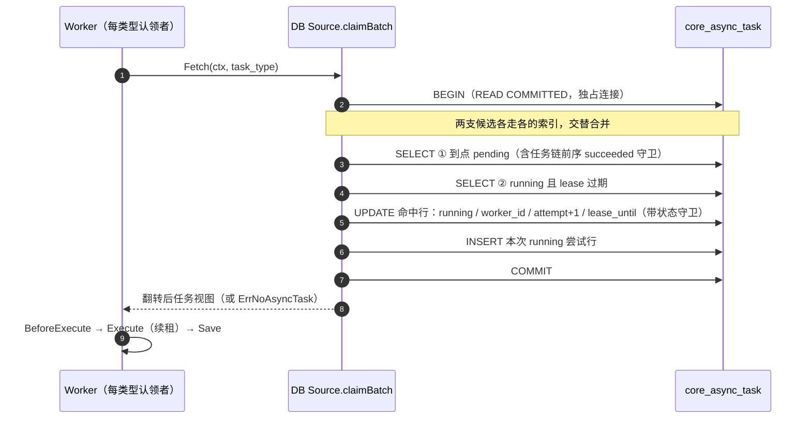
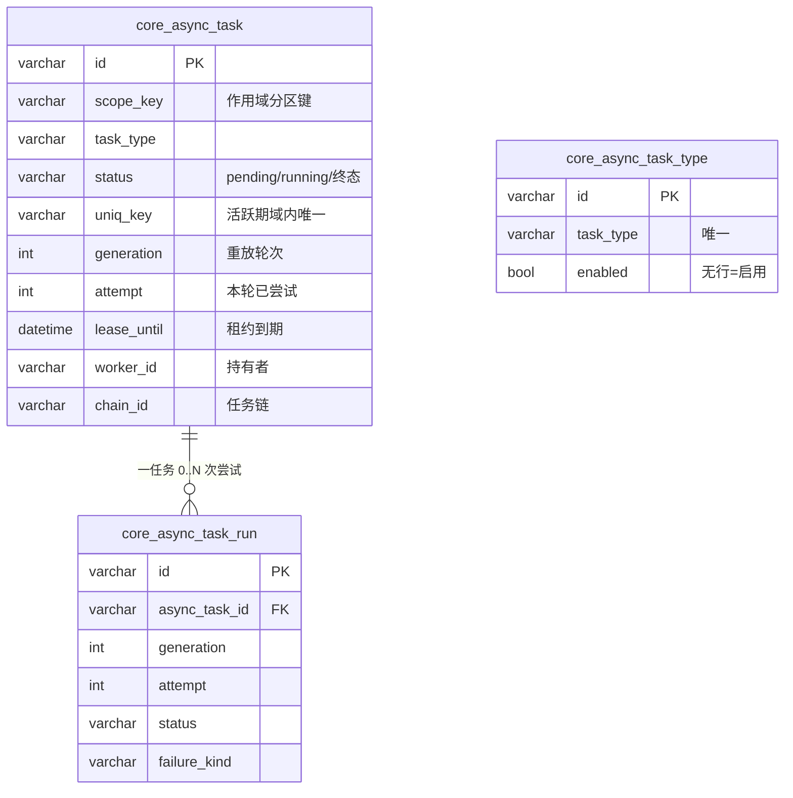

# task/gasync 设计文档（有状态任务中心 + 执行运行时）

> 定位：本文是 **设计文档**（架构、取舍、机制与决策）；**使用手册见 [`README.md`](README.md)**。
> 状态：草案待评 ｜ 作者：gasync 维护者 ｜ 评审人：待指派（架构 / 正确性 / 调用方各一） ｜ 拍板人：仓库 owner ｜ 最后更新：2026-11-19
> 档位：**标准档** ｜ 落点：**B 既有系统的新模块**（宿主为 `golib/task` 任务族，gasync 是其中已成型的子模块） ｜ 场景：**主 S2 增量改造**（契约演进如作用域维度、远程形态；补充 S6 专项优化：认领/续租的并发正确性） ｜ 专题：架构设计、API 设计、数据模型设计、性能与容量

本文无上游 PRD，自建需求编号（R1…Rn），来源在「假设与约束」中声明；追溯表见「决策与需求对照」。文中事实论断的证据锚点形如 `路径:行号`，均为撰写时对当前分支 `feat/gasync-worker-result-handler` 的实际读取结果。

---

## 摘要

`task/gasync` 把一条后台任务当作**有状态实体**管理：提交落库、执行侧通过可替换的 `Source` 取任务执行、任务可查状态 / 取消 / 重放、保留每次尝试记录、多实例下靠**租约（lease）**保证同一任务同一时刻只被一个执行者持有。它同时提供「全量任务中心」与「简单纯异步」两种用法，以及「本轮询/唤醒」「本地 DB / 远程 HTTP」两组可替换实现。

**这份方案要固定的是它已经想清楚、但散落在代码与 README 里的设计决策**，重点收敛三处真正需要设计的难点：C1 所有权与重复执行的真相归属、C2 认领在「正确性 vs 吞吐」间的查询设计、C3 副作用与状态不能分裂的事务次序。其余（鉴权、日志、分页、部署、监控接入）按团队规范执行、不展开。

关键取舍一句话：**以数据库租约作为「谁在执行」的唯一真相，执行期靠续租证活、失权即弃、Save 在事务内先锁行再跑钩子**——牺牲的是「崩溃后最多一个 LeaseTTL 才能被接管」的实时性，换取的是**数据库归属层**的两条强不变量：「同一任务任一时刻不被两个执行者同时持有」「失权者不写脏终态、不触发 `Save` 内的 lifecycle 回调」。需要明确的是，这只是「至多一个持有者 + 状态不脏」，**不等于「业务副作用只触发一次」**：`Handler.Execute` 里的业务副作用发生在 `Save` 之前、不受租约门控，接管会重跑 `Execute`，所以业务副作用须由 handler 自己做幂等（详见 C1/C3）。

---

## 背景与目标

### 宿主约束与遵从 / 偏离（落点 B）

gasync 位于 `golib/task` 任务族，宿主是这套 Go 组件库与它已有的工程约定。它必须服从的宿主约束如下，全部落实、无偏离：

- **持久化统一走 GORM**，与 `task/gcron` 同源；两表**无软删除**（`gormdao` 场景须 `WithoutSoftDelete()`），gasync 内部直接用原生 `*gorm.DB` 以避开误加 `deleted_at IS NULL`（`source/db/claim.go:15-20`）。
- **建表由创建实例时默认 `AutoMigrate`（幂等）**，与 `gcron` 一致（`task/README.md`「建表与迁移」）；DDL 的终局形态另备 `ddl/mysql.sql`、`ddl/postgres.sql`。
- **日志与链路沿用 `glog`/`gtrace`**，trace 不落库、仅在日志链路打点（`task/README.md` 标识模型段）。
- **依赖边界**是硬约束：`source/db` 只依赖根包 + gorm；`worker` 只依赖根包（不 import gorm / manager / source/db）；`manager` 单向依赖 `source/db`、无反向环。循环引用会直接 `go build ./...` 失败。
- **数据库方言**须同时覆盖 MySQL 8.0+、PostgreSQL 12+、SQLite（测试兜底），方言差异集中在 `source/db/dialect.go`。

### 业务背景与现状

任务中心的价值在于「一次性投递、可被可靠执行一次、可查可撤可重放」。现有实现已成型，规模与结构如下（证据为当前分支读取）：

| 维度 | 现状 | 证据锚点 |
|---|---|---|
| 代码规模 | 约 1.18 万行（含测试）；核心非测试文件集中在根包 / manager / worker / source | `wc -l task/gasync/**/*.go` |
| 分层 | 根包契约内核 → `manager` 门面 / `worker` 运行时 → `source/db`、`source/remote` 两个 Source 实现 → `wire` 协议、`center` 参考中心、`ginasync` HTTP 适配 | `task/gasync/*.go`、`source/*`、`wire/wire.go:1-9` |
| 状态机 | `pending → running → 终态`；终态含 `succeeded/failed/timeout/canceled/skipped`；`Replay` 回 `pending` | `task.go:16-24`、`manager/manager.go:467` |
| 认领语义 | 事务内两支 SELECT（到点 pending + 租约过期接管）各走各的索引后合并，一次 UPDATE 翻转，同事务建 running 尝试行 | `source/db/claim.go:41-140` |
| 存活性 | 认领即持有租约，执行期按 `LeaseTTL/3` 续租，失权返回 `ErrLeaseLost` 并取消执行 ctx | `source/db/lease.go:39`、`worker/handler.go:253` |
| 幂等 | `(scope_key, uniq_key)` 活跃期唯一；冲突忽略插入（`INSERT IGNORE` / `ON CONFLICT DO NOTHING`） | `manager/manager.go:302`、`source/db/uniqindex.go`（`MigrateActiveUniqIndex`） |
| 后台维护 | `manager.Start(ctx)` 起循环：回收残留尝试行 + 判死「次数用尽 + 租约过期」+ 按 `Retention` 清理终态 | `manager/manager.go:573`、`source/db/lease.go:82-170` |

### 痛点分析

痛点不是「功能缺失」，而是「几个正确性不变量只靠代码和测试隐性维持，一旦被改坏会静默产生重复执行或脏终态」。它们正是本文要固化的挑战点：

- **P1 重复执行面**：多实例、崩溃接管、停机交接、取消后晚到的结果——任一路径处理错，都会出现同一任务两次执行或两种结局并存。现状靠「Save 事务内锁行 + 状态守卫 + 清理 worker_id」多处配合堵死（`source/db/source.go:111-178`、`manager/manager.go:425-449`），规则复杂、易被后续改动破坏。
- **P2 认领的正确性与吞吐互相拉扯**：认领既要「到点优先且有序」又要「租约过期的接管候选不被饿死」，还要在跨方言下拿到一致的原子性（MySQL/PG 的 `FOR UPDATE SKIP LOCKED` vs SQLite 无锁）。现状是两支 SELECT 各走索引后合并 + 单次翻转的妥协（`source/db/claim.go:82-160`），设计意图只写在注释里；且 `Fetch` 实际以 `want=1` 认领（`source/db/source.go:52`），合并策略在单条认领路径上的效果需要单独辨明（见 C2）。

### 目标与非目标

**业务目标（底线）**：任何任务在崩溃、接管、取消、重放等异常路径下，都不会被两个执行者同时推进到「已产生副作用」；调用方总是能用一个稳定标识查到任务的真实状态与每次尝试。

**技术目标（可衡量）**：

| 编号 | 目标 | 口径 / 证据 |
|---|---|---|
| R1 | 同一任务同一时刻至多一个持有者 | 认领事务 `status` 守卫 + `worker_id` 唯一持有；`TestRealA1ConcurrentClaim`、`TestClaimTakeOverExpiredLease` |
| R2 | 失权者不写脏终态、不触发 `Save` 内 lifecycle 回调 | `Save` 失权返回 `ErrLeaseLost` 且**不跑 callback**（`source/db/source.go:122-123`）；`TestSaveAfterCancelReturnsLeaseLost`、`TestSaveAfterReleaseReturnsLeaseLost`。注意：业务副作用在 `Handler.Execute`（`Save` 之前、不受门控），故 R2 不等于「业务副作用不重复」，那需 handler 幂等 |
| R3 | 崩溃后任务可在有界时间内被接管 | 租约过期后由认领 ② 支接管；② 被积压饿死时由回收器 requeue/判死兜底（D8），使上界恒为 `LeaseTTL + ReaperInterval` |
| R4 | 幂等投递在并发下原子去重 | 唯一约束原子完成，`TestA3SameKeyConcurrent`、`TestA3NoKeyTwoRows` |
| R5 | 远程 worker 与本地 worker 执行流程等价 | `TestA12_SourceReplaceable`、`TestCenter_FetchHeartbeatCallback` |
| R6 | 认领查询命中索引、不退化全扫 | `TestRealA8Explain`、`TestRealT10ClaimPlan`（真库 EXPLAIN 校验） |

**非目标（超出范畴的用例，及原因）**：本期不提供跨租户的任务授权模型（`scope_key` 只做隔离分区与 fail-closed，不做权限判定，权限由接入层负责）；不提供任务依赖图（只支持线性步骤链 `SubmitAfter`，通用 DAG 需要独立的调度器，另立项目）；不内建「分布式定时触发」（周期触发是 `task/gcron` 的职责，二者推荐组合而非合并）。

**反目标（技术全达标、业务上仍算失败）**：即使 R1–R6 全绿，若「执行期续租周期」被配得过大导致崩溃接管慢于运维容忍度，或 `LeaseTTL` 在 worker 与 manager/DB 三处不一致导致正常执行被误判失权，业务上仍算失败——因此这两项在「接入要点」里列为硬校验而非可调项。

### 约束与非功能需求

- **一致性**：认领、`Save` 终态推进、`Cancel`、`Replay` 均在数据库事务内完成；跨表（`core_async_task` 与 `core_async_task_run`）在同一事务内成对更新。
- **性能（基线待压测，见 R6）**：认领查询须走 `idx_core_async_task_claim` 与 `idx_core_async_task_status_lease_until`，禁止合成一条 OR 导致两索引都失效（`source/db/claim.go:70-79` 注释）。轮询默认间隔 500ms，空闲时每类型仅 1 路轮询，不随并发数放大（`worker/worker.go` 每类型 1 认领者）。
- **可用性口径**：单任务「提交 → 被认领 → 执行 → 落终态」的时延上界由 `PollInterval` 与执行时长共同决定；崩溃接管上界为 `LeaseTTL + ReaperInterval`（默认 `60s + 30s`）。
- **合规 / 安全**：任务 payload 上限默认 `MaxPayloadBytes=4096`，超限直接 `ErrPayloadTooLarge` 不截断（`manager/manager.go:184-185`），避免超大行拖垮 DB；payload 不落日志明文。
- **方言一致**：`Save` 的方言差异（MySQL 的 upsert 语义）与 PostgreSQL 的 `Labels` 过滤必须真库验证，skip 不等于验证过（`task/gasync/README.md:408-409`）。

### 验收标准

| 项 | 怎么验 | 阈值 / 判据 | 责任方 |
|---|---|---|---|
| 不双跑 | 并发认领 + 接管用例（`TestRealA1ConcurrentClaim`、`TestClaimTakeOverExpiredLease`） | 同一 `id` 任一时刻 `worker_id` 唯一 | 维护者 |
| 失权不产生副作用 | `TestSaveAfterCancelReturnsLeaseLost` 等 | 失权时钩子零调用、终态零写入 | 维护者 |
| 认领走索引 | 真库 EXPLAIN 快照（`TestRealA8Explain`） | 命中预期索引，无 `ALL` 全扫 | 维护者 |
| 幂等原子 | 并发同键提交（`TestA3SameKeyConcurrent`） | 并发 N 次只落一条活跃行 | 维护者 |
| 远程等价 | `TestA12_SourceReplaceable` | 本地 / 远程同一 Handler 结论一致 | 维护者 |

---

## 挑战点与取舍

系统里真正需要设计的是三处，其余都是行业标准答案。**C1** 是所有权真相归属，**C2** 是认领查询在正确性与吞吐上的冲突，**C3** 是「状态可回滚、副作用不可回滚」的事务次序。三者之外（鉴权、logging、分页、部署、监控接入、CI）按团队规范执行，本文不展开。

### C1 所有权真相归属：谁在执行，以谁为准【信号：状态所有权不清 + 失败不可逆】

**为什么难**：一条任务在分布式环境下有多个「可能的执行者视角」——认领者以为自己在跑、崩溃者的 goroutine 可能还在后台、被取消后原执行者可能晚到。若「谁持有任务」没有单一真相，就会出现两个执行者都认为自己有权写终态、或旧执行的晚到结果覆盖新执行的结果。这是典型的**状态所有权不清**，且一旦写错（重复扣款、重复发券）就是**失败不可逆**。

**设计**：以**数据库行的租约列**为唯一真相，`worker_id + status + generation + attempt` 四元组共同定义「谁持有」。四条规则闭环：

1. **认领即持有**：认领事务把 `status=running`、`worker_id=<本执行者>`、`attempt+1`、`lease_until=now+LeaseTTL` 一次写入（`source/db/claim.go:120-140`）。
2. **续租证活**：执行期按 `LeaseTTL/3` 续租，续租 SQL 带 `WHERE id=? AND worker_id=? AND scope_key=? AND status='running'`，`RowsAffected==0` 即失权，回读状态区分「被取消」还是「被接管」（`source/db/lease.go:39-70`，SQL 在 44-46）。worker 侧连续失败 2 次（`renewMaxConsecutiveFailures`）即判定失权并取消执行 ctx（`worker/handler.go:287`、`worker/worker.go:121`）。
3. **Save 校验归属**：写终态前先锁行、确认 `worker_id/status/generation/attempt` 仍匹配，不匹配返回 `ErrLeaseLost`（`lockOwnership` 在 `source/db/source.go:180-189`，`ErrLeaseLost` 返回在 `source/db/source.go:122-123`）。**只看 worker_id 不够**——同进程共用的 worker_id 会让陈旧 goroutine 把别人重认领后的任务误当成自己的，故必须校验 generation/attempt。
4. **主动放弃用 Release 不清表**：停机 / 认领后无法交付时，把 `lease_until` 置为已过期并**清空 `worker_id`**，让另一实例立即接管（`source/db/source.go:83-91`）。清 `worker_id` 是关键：被放弃那次若稍后才返回，`Save` 的归属校验会命中 0 行直接失权，杜绝「放弃了还写进来」。

**取舍与代价**：真相归 DB 行、靠租约证活，代价是**崩溃接管有下界延迟**（最多 `LeaseTTL`，默认 60s，加回收周期共约 `LeaseTTL + ReaperInterval` ≈ 90s）；但这条上界只对「被 ② 支接管或回收器判死」的任务成立，**对持续有积压的 task_type 下的接管候选并不保证**（见 C2：`want=1` 时 ② 支可能被饿死）。此外它对时钟与 **`LeaseTTL` 一致性**敏感（manager 模式下实际是 worker 侧与 manager 侧两处，manager 会把 `Config.LeaseTTL` 注入 `source/db`，见「接入要点」）。替代方案（见「备选」）是「以外部注册中心 / Redis 心跳为准」，判死延迟可降到秒级以内但引入额外组件与一致性问题——不选。

**本 C1 说不覆盖什么（划清边界）**：C1 保证的是「至多一个持有者 + 不写脏终态」，**不保证业务副作用只触发一次**——接管会重跑 `Handler.Execute`，副作用责任在 handler 幂等。**不该用它的场景**：若业务要求「副作用至多一次且不可承受重复」，仅靠租约不够，必须在 handler 内用 `AsyncTask.ID + Generation + Attempt` 做幂等键，或改用带事务性副作用的方案。

### C2 认领查询：正确性 vs 吞吐的索引妥协【信号：约束冲突（快 vs 准）+ 数量级跨越（单机 → 多实例并发认领）】

**为什么难**：「到点待执行」与「租约过期可接管」是两类不同候选，各自有最合适的索引；把它们合成一条带 `OR` 的 SQL，优化器就无法同时对两个索引生效，退化成按 `task_type` 区间逐行过滤（`source/db/claim.go:70-79` 注释）。同时跨方言的原子性形态不同：MySQL/PG 可用 `FOR UPDATE SKIP LOCKED` 在事务内锁候选行，SQLite 无此语义只能靠「带状态守卫的 UPDATE」兜底。

**设计**：**两支 SELECT 各走各的索引 + 一次翻转**；两支候选的合并策略与「每次认领几条」强相关，须按 `want` 分别说明。

- ① 到点 pending：`status='pending' AND next_run_at<=now AND attempt<max_attempts AND 任务链前序 succeeded`，走 `idx_core_async_task_claim`（顺序与 `ORDER BY priority DESC, next_run_at` 逐列一致，免排序）。
- ② 租约过期接管：`status='running' AND lease_until<now AND task_type=?`，走 `idx_core_async_task_status_lease_until`（`task_type=?` 不在该索引内，多类型混合表下 ② 会先取全表过期 running 再按 type 过滤——这是该支的已知代价）。
- **合并策略 `interleaveByID`**（`source/db/claim.go:151`）：**它只在 `want≥2`（批量认领）时才真正防饿死**；`Fetch` 实际以 `want=1` 认领（`source/db/source.go:52`），此时循环第一次就 `pick(r1[0])` 后因 `len(out)>=want` 退出，`r2[0]` 进不来——**只要该 task_type 有到点 pending，② 接管候选在单条认领路径上仍会被饿死**。这是一个真实的设计缺口，不是文档措辞问题：一个「attempt 未用尽、租约已过期、且其 task_type 持续有积压」的任务，既拿不到 ② 的认领（饿死），也不满足 `reapDeadAsyncTasks` 的 `attempt >= max_attempts` 判死条件（`source/db/lease.go:133`），会被长期卡在 running，**C1 的「接管上界」在这类积压下不成立**。
- **单次翻转 + 状态守卫**：`UPDATE ... SET status='running' ... WHERE id IN (...) AND status IN ('pending','running')`，SELECT 与 UPDATE 之间若该行被 Cancel（SQLite 无行锁时可能），状态守卫阻止把它「复活」回 running（`source/db/claim.go:120-140`）。
- **认领即建 running 尝试行**（`insertRunningRuns`，同事务），使尝试记录起止时间真实，且进程崩溃留下的 running 行能被回收器 ① 收口。

这一认领事务的完整时序图见「方案设计 → 核心流程」中的认领时序：两支候选各走各的索引、一次翻转带状态守卫、同事务建尝试行。

**落着**：认领 = 一个事务内的翻转 + 建行，在不引发全扫的前提下保证 R1（唯一持有）。R3（接管候选能被选中）在 `want=1` 下**不靠 interleave 保证**，而是由回收器的 requeue/判死相位兜底（决策 D8）——认领负责「有活就干」，回收器负责「卡住的有人救」，二者分工，正确性不落在调度顺序上。

**取舍与代价**：牺牲「一条 SQL 搞定」的简洁，换来索引可用。**这个缺口已定论**（见「决策结论」Q4→D8）：不做「放宽判死」也不依赖「批量认领」来兜底，而是**在回收器补一个 requeue 相位**——租约过期且仍有剩余次数的 running 任务回退 pending 重新入队，使救活上界恒为 `LeaseTTL + ReaperInterval`、与 pending 积压无关。理由：正确性不能依赖认领调度顺序（load-dependent），回收器是定时驱动、唯一能给无条件有界保证的位置。**不该用它的场景**：单机单实例、无接管需求时用简单 `pending` 单支认领即可。

### C3 副作用与状态不可分裂：Save 的事务次序【信号：失败不可逆】

**为什么难**：`Save` 要协调两类性质不同的动作——更新任务/尝试状态（可回滚）与执行 `callback`（`Source.Save` 的 `EnsureFunc`）。需要澄清：传进 `Save` 的 `callback` 由 `worker.buildCallback` 生成，它**只是本进程 Lifecycle 的旁路回调**（`OnSuccess/OnRetry/OnFailure` 等，`worker/handler.go:85-108`），**不是**扣款/发消息那类业务副作用——真正的业务副作用在 `Handler.Execute` 里、在 `Save` 之前就已产生。若先写终态失败的场景处理错，就会出现「状态没落、回调却发了」或「失权仍发回调」。这是**失败不可逆**的典型（针对可回滚的状态与不可回滚的回调而言）。

**设计**：把顺序本身写成契约——**锁行确认归属 → 收尾尝试行 → 按结局推进状态并在同一事务内跑 `callback`**（`source/db/source.go:111-178`）。

- 失权（`lockOwnership` 返回 false）时**直接返回 `ErrLeaseLost`，不跑 `callback`**：「不跑」比「跑了不记」正确，因为状态可回滚、回调副作用不可回滚。
- 成功 / 失败路径：`callback` 与终态写入在**同一事务**内，`callback` 拿到的是事务句柄（`gasync.WithTx` 注入 ctx，`TxFromContext` 可取出 `*gorm.DB`），`callback` 返回错误则整个事务回滚，回调与状态同成败。
- **Canceled 分支是例外（已定论，D9）**：`OutcomeCanceled` 时 `_ = callback(cctx)` **显式吞掉回调错误**再照常提交终态（`source/db/source.go:142-147`）——这是**有意且正确的不对称**：取消是用户发起的终态意图，若像成功/失败那样回滚事务，会让已取消的任务「复活」，比丢失旁路回调严重得多。代价是 `OnCanceled` 失败仅记日志、不保证送达（见「决策结论」Q5→D9）。
- 失败是否重试**由 Source 判定**（`HasRemainingAttempts`），不由 Worker 决定；次数用尽时超时归 `StatusTimeout`（独立状态），其余归 `StatusFailed`，并在 `FailFastChain` 开启时级联取消同链后续 step（`source/db/source.go:151-176`）。

**取舍与代价**：`callback` 在事务内、依赖数据库事务可回滚——这意味着**远程 Source 无法提供事务**（`TxFromContext` 返回 nil，`source.go:78-90`），远程形态下回调内的副作用幂等责任落在业务侧。这是有意的：远程 worker 不连库，就没有能跨网络回滚的事务。**业务副作用（`Execute` 内）本就不可回滚**，无论本地远程都须由 handler 自己幂等（`AsyncTask.ID + Generation + Attempt`）。**不该用它的场景**：回调里做跨系统写入（调第三方 API）时，事务回滚撤不掉远端副作用，此时业务必须实现幂等键。

---

## 方案设计

### 系统上下文与边界

gasync 的边界是「任务的有状态管理与执行编排」：它不负责任务的**触发时机**（周期触发在 `gcron`）、不负责**业务逻辑本身**（`Handler.Execute` 由业务实现）、不负责**鉴权与租户权限**（`scope_key` 只做隔离分区，权限在接入层）、不负责**数据库连接与读写分离**（调用方注入 `*gorm.DB` 写主库）。

**边界结论**：认领保全局、`Fetch` 不加作用域过滤，跨域可见性靠部署隔离与 handler 校验（见「作用域」）。依赖方向与可替换点见下一节「总体架构」的分层图。

### 总体思路

核心做法一句话：**根包定义契约与状态机，`Source` 定义「任务从哪来、结果往哪去」的接缝，`manager` 与 `worker` 在接缝两侧各自独立演进**。

由此推出三条结构性质：其一，提交与执行解耦——只提交的进程不需要 `worker`，只执行的进程不需要 `manager`；其二，换 `Source` 实现（DB ↔ 远程）不改 `worker` 与 `Handler`，同一份 handler 可在本地/远程两种执行节点运行；其三，状态机与错误语义集中在根包，是 `manager` 与 `worker` 唯一的共同依赖面，避免了二者直接耦合。

### 总体架构

下图是分层架构与依赖方向，用于说明「谁依赖谁、边界在哪、哪些可替换」。读图要点：`worker` 只依赖根包与 `Source` 接口，`manager` 单向依赖 `source/db`，`wire` 由客户端（`source/remote`）、服务端（`center`）、HTTP 适配（`ginasync`）三方共用一份。


图中每个节点在正文都有对应解释：调用方（提交 / 执行两种进程）、接入与门面（`manager`/`worker`/`ginasync`）、契约内核（根包 + `wire`）、`Source` 实现（`source/db`、`source/remote` + `center`）、外部依赖（关系数据库、可选远程中心）。

架构分四层，职责与数据所有权如下（与上图一致）：

| 层 | 组件 | 职责 | 数据所有权 |
|---|---|---|---|
| 调用方 | 提交侧 / 执行侧进程 | 提交任务、注册 handler、起停运行时 | 不持有任务真相 |
| 接入与门面 | `manager`、`worker`、`ginasync` | 提交/查询/取消/重放/统计、执行编排、HTTP 暴露 | `manager` 拥有任务中心写入口；`worker` 无持久化 |
| 契约内核 | 根包 `gasync`、`wire` | 实体、状态、`Source` 接口、错误哨兵、跨网络协议 | 根包只定义结构，不持有数据 |
| `Source` 实现 | `source/db`、`source/remote`、`center` | 认领/续租/保存/回收/清理；远程 HTTP 三段 | `source/db` 拥有 `core_async_task*` 全部 SQL |

### 核心流程

执行与落终态的流程如下（`worker/handler.go:119-253`）：认领 → （可选作用域注入）→ `BeforeExecute`（返回 `ErrSkip` 则写 skipped、无回调）→ `Execute`（带 `execCtx`，超时/停机/失权都通过取消 ctx 传递）→ 续租协程按 `LeaseTTL/3` 续租、失权即 `cancelExec` → `Save`（见 C3）。异常分支：超时归 `StatusTimeout`；panic 记 `failure_kind=panic`；续租连续失败判失权。

认领是整个流程里唯一需要跨方言拿原子性的环节，其内部时序如下——「两支候选 → 一次翻转 → 建尝试行」在同一事务内完成：



**落着**：这张图把「认领」与「尝试记录创建」的原子性锁在同一事务里；它在不引发全扫前提下保证 R1（唯一持有），但**接管候选能否被选中取决于认领批量**——见 C2 对 `want=1` 缺口的说明。代价是认领对数据库写有依赖，认领本身不是「只读一次就完」。

### 备选方案与取舍

| 备选 | 一句话 | 为何不选 / 何时选它 |
|---|---|---|
| **不做任务中心，纯 goroutine 异步** | 提交即 `go func`，进程内执行 | 崩溃即丢、无状态可查、无跨实例去重；只在「丢了也无所谓」的场景够用 |
| **外部 MQ（Kafka/Redis Stream）承载** | 用 MQ 的消费确认 + 重投递 | 引入额外组件、状态查询要靠 MQ 元数据或另建表、跨实例不重跑靠 MQ 语义；gasync 的「可查/可撤/可重放/每次尝试留痕」超出 MQ 原生能力，选 DB 型任务中心 |
| **以 Redis 心跳代替 DB 租约判活** | Redis TTL 更快判死 | 引入 Redis 依赖；DB 租约零额外组件、与任务行同源、崩溃判死口径统一（C1 已选） |
| **DB 租约 + 可替换 Source（本方案）** | 现状 | 唯一真相在 DB 行、接缝可换远程；代价是接管有 `LeaseTTL` 下界（接受） |

### 技术选型与理由

- **持久化选关系库（GORM）而非 KV**：需要「事务内多表成对更新 + 唯一约束原子去重 + 富查询（label/时间/biz）」，KV 无法原子跨键。代价是认领并发受 DB 行锁/隔离级别约束（C2 已处理）。**不该选它的场景**：极高吞吐（十万级 QPS 提交）时 DB 写放大明显，应前置消息队列削峰。
- **`Source` 抽象而非直接绑 DB**：`worker` 只依赖 `Source` 接口，使本地/远程两种执行节点共用同一份 `Handler`+`Worker`（R5）。代价是远程形态丢失事务（C3）。
- **跨网络协议独立成 `wire` 包**：客户端/服务端共用一份类型定义，防止两侧漂移（`wire/wire.go:1-9`）。代价是多一个包，但换来实现改动只在一处。

### 决策与需求对照

| 决策 ID | 决策（Y-statement） | 挑战点 | 承接需求 | 备选（含不做） | 验证手段 | 状态 | 置信度 |
|---|---|---|---|---|---|---|---|
| D1 | 以 DB 行租约（`worker_id+status+generation+attempt`）为唯一真相，续租证活、失权即弃 | C1 | R1/R2/R3 | Redis 心跳判活 | `TestRealA1ConcurrentClaim`、`TestRenewLostToOtherWorker` | Accepted | 高 |
| D2 | 认领两支 SELECT 各走索引 + 单翻转守卫；`want=1` 时 ② 接管候选可能被饿死（救活兜底已决于 D8） | C2 | R1/R6（R3 由 D8 兜底） | 单条 OR、MQ 分发 | `TestRealA8Explain`、`TestClaimTakeOverExpiredLease` | Accepted | 中 |
| D3 | `Save` 锁行校验归属 → 收尾尝试 → 同事务跑钩子；失权不跑钩子 | C3 | R2 | 先跑钩子再写终态 | `TestSaveAfterCancelReturnsLeaseLost`、`TestRealSaveHookAndStatus` | Accepted | 高 |
| D4 | 幂等用 `(scope_key, uniq_key)` 活跃期唯一 + 冲突忽略插入 | 标准做法 | R4 | 先查再插（并发不安全） | `TestA3SameKeyConcurrent` | Accepted | 高 |
| D5 | `Source` 接缝 + `wire` 共用协议，支持本地/远程等价执行 | C1/C3 | R5 | 直接绑 DB、不抽象 | `TestA12_SourceReplaceable` | Accepted | 高 |
| D6 | 后台维护循环：回收残留尝试 + 判死次数用尽 + 按 Retention 清理 | 标准做法 | R3 | 不起维护循环（卡死任务永久 running） | `TestManagerMaintenanceReapsStuckTask` | Accepted | 高 |
| D7 | 作用域 `scope_key` 只做隔离分区 + fail-closed，不做权限 | 标准做法 | — | 内建权限模型 | `TestFetch_CarriesScope`、`TestFetch_MissingScopeDefaultsPlatform` | Accepted | 中 |
| D8 | 卡死任务的**有界救活**交给回收器（timer 驱动、与认领调度无关），不依赖 `interleave`：新增「租约过期的 running 且仍有剩余次数 → 回 pending」的 requeue 相位 | C2 | R3 | 依赖 interleave@want=1、worker 批量认领 | 新增 `TestReapRequeueLeaseExpiredWithRemaining` | Proposed（需改代码） | 中 |
| D9 | `Save` 的 Canceled 分支吞 `callback` 错误是**有意且正确**的（取消是终态，回滚会复活已取消任务）；代价是需补一条错误日志 | C3 | R2 | 与成功/失败路径一样回滚 | `TestSaveAfterCancelReturnsLeaseLost` + 日志断言 | Accepted | 高 |

---

## 详细设计

### 模块划分与职责

职责不重叠、数据所有权单一：`manager` 是唯一任务中心写入口（`Submit`/`SubmitAfter`/`Cancel`/`Replay`），`source/db` 是**执行期 SQL**（认领/续租/保存/回收/清理）的唯一持有者；`manager` 另持有管理面原生 SQL（`Cancel`/`Replay`/`Stats` 等对任务表的 `c.db.Exec`，见架构图中 `manager → DB` 这条边），二者共同操作 `core_async_task*`，但写入口语义上仍以 `manager` 对外、`source/db` 对内执行期。`worker` 不碰持久化只做编排（认领 → 执行 → `Save`），根包不持有任何运行时数据、只定义结构与状态。

拆分顺序遵循「先定接缝再分模块」：先由「取任务 / 回传结果」这一职责把系统切成 `Source` 两侧，再在两侧各自装 `manager`（写侧）与 `worker`（执行侧），最后把契约与协议抽到根包与 `wire`。这样 `worker` 换 `Source` 实现不需要改 `Handler`，`manager` 改存储不影响 `worker`——依赖方向是本文的硬约束，循环引用会直接 `go build ./...` 失败。

### 接口设计

**根包 `Source` 接缝**（`source.go:18-34`）是执行侧唯一依赖，五个方法各带所有权契约：`Fetch` 成功即持有租约；`Renew` 失权返回 `ErrLeaseLost`；`Release` 置租约过期（可空实现）；`Save` 失权不跑回调；`Close` 释放连接。

**错误码（哨兵，前缀 `gasync:`）**：调用方按 `errors.Is` 判定。关键语义：

| 哨兵 | 语义 | 调用方动作 |
|---|---|---|
| `ErrLeaseLost` | 已失权（被接管/取消/终态） | 停止执行、放弃钩子 |
| `ErrNotify` | 已落库、通知未发出 | **勿重试提交**，兜底轮询接手 |
| `ErrNoAsyncTask` | 当前无待执行任务 | fetch 侧按退避再取 |
| `ErrScopeRequired` | 未声明作用域且 fail-closed | 接入层补作用域 |
| `ErrPayloadTooLarge` | payload 超上限（不截断） | 调用方截断或改走引用 |

**`Submit` 三值语义**：`err==nil` 成功；`err==ErrNotify` 已落库但通知没发（不重试）；`submitted` 区分是否新建（幂等键命中时为既有任务）——并发提交同键时靠它判断复用，而非靠 `err`。

### 数据模型

三张表，实体清单、字段与索引如下；DDL 见附录。

**实体清单**：

| 实体 | 表 | 生命周期 | 量级（估） |
|---|---|---|---|
| 任务 | `core_async_task` | `pending→running→终态→(Replay)pending` | 活跃行数 ≈ 在途任务量；终态行按 `Retention` 清理 |
| 尝试 | `core_async_task_run` | 认领即建 running 行，`Save` 收尾 | ≈ 任务数 × 平均尝试次数 |
| 类型开关 | `core_async_task_type` | 无行 = 启用（fail-open） | ≈ 任务类型数 |

**关键字段（节选，完整见附录 DDL 与 `source/db/model.go`）**：

| 字段 | 类型 | 说明 |
|---|---|---|
| `id` | varchar(36) PK | UUID v4 |
| `scope_key` | varchar(64) not null default '' | 作用域分区键；空 = 未声明 |
| `status` | varchar(16) | pending/running/终态 |
| `uniq_key` | varchar(128) null | 活跃期域内唯一，空串写 NULL |
| `generation`/`attempt`/`max_attempts` | int | 重放轮次 / 本轮已试 / 上限 |
| `lease_until` / `worker_id` | datetime / varchar | 租约到期 / 持有者（C1 真相列） |
| `chain_id`/`step`/`prev_step` | varchar/int/int | 任务链；`prev_step=-1` 为首步 |
| `next_run_at` | datetime | 最早可认领时间 |

**索引与所服务的查询**（每条回指具体查询）：

| 索引 | 服务的查询 |
|---|---|
| `idx_core_async_task_claim` | 认领 ①到点 pending（`task_type,status,priority DESC,next_run_at`，与 ORDER BY 一致免排序） |
| `idx_core_async_task_status_lease_until` | 认领 ②租约过期接管、回收器判死 |
| `idx_core_async_task_status_finished_at` | 清理按 `finished_at` 删终态（`Cleanup`） |
| `idx_core_async_task_task_type_status_created_at` | 管理面 `List` 按 task_type + status 倒序分页 |
| `idx_core_async_task_biz_type_biz_id` | 管理面按业务对象查（`AsyncTaskCond{BizType,BizID}`） |
| `idx_core_async_task_scope_created_by_created_at` | 按 scope + created_by 拉「我的任务」倒序分页 |
| `idx_core_async_task_chain_id_step` | 任务链前序 step 判成功（认领 ① 子查询） |
| `idx_core_async_task_scope_uniq_key` | 幂等冲突回查（`findByUniqKey`，普通非唯一索引） |
| `uk_core_async_task_active_uniq` | 活跃期唯一（PG 部分索引 / MySQL 生成列 `uniq_key_active`，仅 pending/running 非 NULL，故终态后同键可重建；由 `MigrateActiveUniqIndex` 补建） |

下图是简版关系导航，只画实体、主键与关系基数；字段与索引由上表承载，精确形态由附录 DDL 承载。



任务有生命周期与回边状态流转，故配状态图（与数据模型配对）。下图用于说明「重试回退、租约接管、Cancel、Replay」四条回边，读图要点：`running` 是所有回边与终态分叉的枢纽，`pending` 是唯一入口与 Replay 的回归点，五个终态只出不回。


图中每条边在正文都有解释：`pending→running` 认领；`running→pending` 失败且还有次数（退避回退）；`running→`五个终态（成功 / 失败次数用尽 / 超时 / 被 Cancel / `BeforeExecute` 返回 `ErrSkip`）；`running→running` 自回环是租约过期被他人接管；`succeeded→pending` 是 Replay（`generation+1`）。终态只出不回，是被 `uk_core_async_task_active_uniq` 与 `isTerminal` 共同约束的。

### 关键逻辑与算法

- **退避**：默认指数退避 5s 起、上限 10m、抖动 ±20%（`manager/config.go` `DefaultBackoff`），`attempt` 从 1 计；实现做下界保护不低于 1ms。
- **回收器**（`source/db/lease.go:82-170`）：①收口残留 running 尝试行（关联 asyncTask 表判归属，避免把仍在正常续租的超长执行误判为残留，`finished_at` 取 `LEAST(lease_until, now)`）；②判死「次数用尽 + 租约过期」的 running 任务（清 `worker_id/lease_until`，否则僵尸续租会成功）。
- **清理**（`Cleanup`）：条件钉在「终态 + `finished_at`」，pending/running 永不删；事务内先锁候选任务行再删，防止「判到终态 → 被 Replay 回 pending 重认领 → 删掉新一代正在跑的尝试行」。
- **作用域**：`scope_key` 进入幂等唯一键与查询索引；注入 `ScopeResolver` 后读路径叠条件、写路径以 `(id, scope_key)` 守卫、未声明 fail-closed；平台任务用保留值 `__platform__`，旧中心缺省按它兜底（`wire.Task.ToAsyncTask`）。认领本身**不加**作用域过滤（全局），跨域可见性靠部署隔离。

---

## 验证与验收

### 验证手段

按场景裁剪的验证组合：单元测试覆盖状态机与错误路径（`TestRenewLostToOtherWorker`、`TestCancelTerminalIdempotent`、`TestReplayTerminal`）；**真库集成**用例按方言拆子测试（`TestRealXxx/mysql`、`TestRealXxx/postgres`），覆盖并发认领、租约接管、`Save` 钩子与状态、EXPLAIN 索引快照、`Labels` 过滤。

**skip 不等于验证过**：MySQL 的 `Save` 方言差异与 PG 的 `Labels` 过滤必须真库跑过才算数，方言连不上时该子测试跳过、不代表通过。远程形态用 `TestCenter_*` 系列验证 Fetch / Heartbeat / Callback / Release 与取消传播的语义一致。

### 关键假设与证伪实验

**最脆弱假设**：`LeaseTTL` 的续租周期（1/3）与数据库事务时延之间留有足够余量，使正常执行不会被误判失权；这个假设一旦不成立，「失权即弃」会把健康执行误杀，整套 R2 语义反噬。

**证伪实验**（最便宜）：在 `LeaseTTL=900ms` 下注入一次「续租请求卡满自身 timeout」的慢失败，观察是否在截止前误判失权。**不成立时的 Plan B**：把续租判定从「连续 2 次失败」放宽为「距上次成功续租超过 2×LeaseTTL」，并提高续租频率到 `LeaseTTL/4`。

### 观察指标与判据

上线后观察四项指标：`gasync` worker 的续租失败率（应接近 0，除真实接管外）、任务从 `pending` 到 `running` 的时延分布（P99 应 ≈ `PollInterval` 量级）、`Timeout` / `Failed` 占比、清理批次行数。

**回滚触发阈值**：续租误判失权率超 0.1% 即回退 `LeaseTTL` 配置或降低续租频率——这是把「最脆弱假设」落成可观测红线。

---

## 实施计划

本文是「固化既有设计」而非「从零实施」；对于**新增契约**（如再引入一个新维度）的落地，按可独立验证的阶段推进：

- **阶段一（去风险 spike）**：先在测试库对认领/续租/`Save` 做真库并发回归 + EXPLAIN 快照，确认新改不改动既有不变量（R1–R3）。
- **阶段二**：方言覆盖（MySQL `Save`、PG `Labels`）真库跑通，补 DDL 与 `AutoMigrate` 逐列一致校验。
- **阶段三**：远程形态等价回归（`TestA12_SourceReplaceable`）+ 文档与 README 同步。

**时间估算**：契约固化为文档 0.5 人日；若附带代码改动，按改动面 1–3 人日（假设真库测试环境可用，否则加 0.5 人日搭建）。

---

## 风险评估与应对

**技术风险**：`LeaseTTL` 不一致导致正常执行被误判失权——**触发条件**：接入方只配了一处（manager 模式下需对齐 worker 与 manager；直接用 source/db 时对齐 worker 与 source/db；远程形态对齐远端 worker 与中心 manager）；**动作**：构造期校验 + 文档硬校验（接入要点），已列入反目标。

**业务风险**：handler 非幂等——**触发条件**：租约过期被接管、停机超时被接管都会重跑；**动作**：要求 handler 用 `AsyncTask.ID + Generation + Attempt` 做幂等键，写入接入要点。

**技术债**：远程形态下 `Save` 无法提供事务，钩子幂等责任外落到业务；本方案不偿还（跨网络无法回滚），留待「远程中心 + 业务幂等 SDK」专项。`WithPollInterval` 已废弃但仍校验（`manager/config.go`），留作兼容债。

### 方案沉默清单

方案未明说、但上线一定会遇到、遇到就出事的输入/状态：

| 沉默项 | 默认行为 | 由谁确认 |
|---|---|---|
| 提交后从未被任何 worker 认领（worker 全挂） | 任务停在 pending，靠运维发现积压；`manager.Start` 不判死 pending | 运维 / 接入方配监控 |
| handler 忽略 `ctx.Done()` | 超时后仍跑完，`Save` 可能失权但副作用已产生 | 业务 handler 作者 |
| Replay 与 Cleanup 竞争 | Cleanup 事务内先锁任务行，Replay 侧按状态守卫，删不掉新一代 | 已由代码堵死，回归覆盖 |
| 同进程多 worker 共用 worker_id | `Save` 校验 generation/attempt 兜底，不误认领 | 已由代码堵死 |
| payload 超过 `MaxPayloadBytes` | 直接 `ErrPayloadTooLarge`，任务不建 | 调用方 |

---

## 决策结论与开放问题

评审中暴露的两个问题需要从**终局正确性**角度给定论，而不是留成「倾向」。下面给出决策、理由与代价；Q1–Q3 属可延后的演进项，仍作开放问题保留。

### 已决：卡死任务的有界救活放在回收器，不依赖 interleave（对应 Q4 → D8）

**问题回顾**：`Fetch` 以 `want=1` 认领，`interleaveByID` 只在 `want≥2` 生效，故「积压待执行 pending + 租约过期应接管的 running」并存时，② 接管候选会被饿死；而 `reapDeadAsyncTasks` 只判死 `attempt>=max_attempts`，于是「attempt 未用尽 + 租约过期 + 该类型持续积压」的任务会长期卡在 running。

**决策**：把「卡死任务在有界时间内被救活」这一**正确性保证**放在**回收器**，而不是放在认领的合并策略上。

**理由（终局/合理性）**：正确性不能依赖认领调度顺序——认领顺序随负载变化，积压时 ② 永远排不到，这是**load-dependent 的伪保证**。回收器由 `ReaperInterval` 定时驱动、与认领竞争无关，是唯一能给出「无条件、有界」保证的位置。具体做法是给回收器补一个 **requeue 相位**：对「`status=running`、租约已过期、且 `attempt < max_attempts`」的任务，**回退为 `pending`**（保留已递增的 attempt、清 `lease_until`/`worker_id`/`started_at`），让它重新进入 ① 到点队列被任一 worker 认领；`attempt>=max_attempts` 的仍走现有「判死为 failed」相位。这样救活上界恒为 `LeaseTTL + ReaperInterval`，与是否有 pending 积压无关。

**为什么不选另外两条**：其一「worker 批量认领（`want>1`）」把正确性耦合进 worker 取任务架构，且批量可能整批都是 pending、边缘仍在；它更适合作为纯吞吐优化，不作为正确性兜底。其二「放宽 `reapDeadAsyncTasks` 判死」会把本可重试的任务直接判 failed，丢失剩余次数，语义错误。

**代价与边界**：requeue 会让「反复崩溃的坏任务」被反复重排队直到次数用尽（这正是 `max_attempts` 存在的意义，可接受）；requeue 不改 `attempt`，下次认领再 `+1`，计数语义与现有认领一致。这是一处**需要改代码的 Proposed 决策**（当前实现尚无 requeue 相位），落地前需补测试 `TestReapRequeueLeaseExpiredWithRemaining`。

### 已决：Canceled 分支吞掉 callback 错误是有意且正确的（对应 Q5 → D9）

**决策**：保留 `OutcomeCanceled` 时 `_ = callback(cctx)` 的吞错语义，并在契约文档与实现里补一条错误日志。

**理由（终局/合理性）**：`callback` 是 Lifecycle 的旁路回调（`OnCanceled` 等），不是业务副作用本体。取消是用户发起的**终态**意图；若像成功/失败路径那样「回调失败即回滚事务」，事务回滚会让任务回到非终态——**用户取消了的任务又活了**，比「旁路回调丢了」严重得多。成功/失败分支之所以回滚，是因为回滚后任务仍非终态、可重试，语义自洽；取消分支回滚则自相矛盾。因此这种不对称是**设计上正确的不对称**。

**代价**：`OnCanceled` 回调失败会静默（仅日志），不保证送达。需要的人可以把「取消后的通知」做成幂等且带重试的独立逻辑，而不是指望 `Save` 事务回滚。

### 开放问题（可延后，不影响正确性）

| 编号 | 问题 | 默认倾向 | 拍板人 |
|---|---|---|---|
| Q1 | 是否要把远程形态的业务幂等做成 SDK | 倾向做，但本期不做（列技术债） | 仓库 owner |
| Q2 | `WithPollInterval` 废弃字段何时删除 | 下一个大版本删除并记 CHANGELOG | 仓库 owner |
| Q3 | 是否引入 Redis 心跳做更快判活 | 暂不引入，DB 租约够用 | 架构评审 |

## 已知未覆盖

- **跨租户权限模型**：本期只做隔离分区，不做权限判定；撞上时越权保护由接入层负责（超出范畴，见非目标）。
- **通用 DAG 任务依赖**：只支持线性 `SubmitAfter` 步骤链；需要 DAG 时另立项目，撞上时用多个 `ChainID` 拼装。
- **任务触发时机**：周期触发归 `gcron`；本方案不内建定时器。

---

## 调用方使用示例

> 分工：**[`README.md`](README.md) 是唯一的使用手册**（完整 API、形态、配置项、接入要点、测试命令）。本节只为「读懂本设计文档的调用方」补三段最小骨架，说明设计如何落到调用上，不重复 README 的 API 参考；两者冲突时以 README 为准。

本节面向**接入方**：给出三种典型形态的最小可运行骨架，以及几条必须遵守的接入红线。示例只保留主路径与关键约束，完整 API 见 [`README.md`](README.md)。

### 形态 A：简单纯异步（提交侧与执行侧解耦）

「投递 → 执行」拆成两侧，各取所需：提交侧只需 `manager`（不引入 worker），执行侧只需 `source/db` + `worker`（不碰 manager）。

```go
// 执行侧进程：只跑 worker，不需要管理面
package workerapp

import (
	"context"
	"time"

	"github.com/morehao/golib/task/gasync"
	sourcedb "github.com/morehao/golib/task/gasync/source/db" // 包名就叫 db，别名成 sourcedb 以免和 *gorm.DB 变量重名
	"github.com/morehao/golib/task/gasync/worker"
	"gorm.io/gorm"
)

// RunWorkers 启动执行侧。db 是调用方打开好的 *gorm.DB 写主库，gasync 不负责连库。
//
// 建表注意：source/db.New 不建表，只跑 worker 的进程也不碰 manager.New——
// 因此执行侧必须在启动前先把表建好，二选一：
//   (a) 在发布流程里用专用账号调 manager.AutoMigrate(db)（建表入口在 manager，不在 source/db）；
//   (b) 用 DDL（ddl/mysql.sql 或 ddl/postgres.sql）显式建一次（含 uk_core_async_task_active_uniq）。
// 否则首次 Fetch 会报表不存在。
func RunWorkers(ctx context.Context, db *gorm.DB) error {
	src, err := sourcedb.New(sourcedb.Config{DB: db, LeaseTTL: 60 * time.Second}) // 显式给 LeaseTTL，与下面 worker 的一致
	if err != nil {
		return err
	}

	// LeaseTTL 必须与 sourcedb.Config.LeaseTTL 一致：Worker 用它决定续租周期（LeaseTTL/3）。
	// 两处都写死 60s，避免读者只改一处导致误判失权。
	w := worker.New(src, &worker.WorkerConfig{Concurrency: 10, LeaseTTL: 60 * time.Second})
	_ = w.Register("email:send", worker.HandlerFunc(func(ctx context.Context, t *gasync.AsyncTask) error {
		var p EmailPayload
		if err := t.Bind(&p); err != nil { // payload 反序列化失败：不重试，直接 failed
			return worker.ErrNoRetry
		}
		return sendEmail(ctx, p) // 必须幂等 + 必须响应 ctx.Done()
	}))

	if err := w.Start(ctx); err != nil { // 同步非阻塞，不写 go 关键字
		return err
	}
	defer w.Shutdown(context.Background()) // 实际用带超时的 ctx
	return nil
}
```

```go
// 提交侧进程：只提交，不跑 worker（可同进程也可分离）
package producer

import (
	"context"

	"github.com/morehao/golib/task/gasync"
	"github.com/morehao/golib/task/gasync/manager"
	"gorm.io/gorm"
)

func SubmitEmail(ctx context.Context, db *gorm.DB, payload []byte) error {
	center, err := manager.New(&manager.Config{}, db) // 默认 AutoMigrate 建表
	if err != nil {
		return err
	}
	defer center.Close()

	_, _, err = center.Submit(ctx, &gasync.AsyncTaskSpec{Type: "email:send", Payload: payload})
	return err
}
```

### 形态 B：完整任务中心（查状态 / 取消 / 重放 / 管理面）

```go
// 起任务中心 + 内置执行循环
center, err := manager.New(&manager.Config{}, db) // 默认 AutoMigrate 建表
if err != nil {
	return err
}
defer center.Close()

// 必须显式启动维护循环：否则「次数用尽后崩溃」的任务会永久停在 running，
// 终态记录也不会按 Retention 清理。
if err := center.Start(ctx); err != nil {
	return err
}

w := worker.New(center.Source(), &worker.WorkerConfig{
	Concurrency: 10,
	LeaseTTL:    60 * time.Second, // 必须与 manager.Config.LeaseTTL 一致
}) // 复用 manager 内部的 DB Source
_ = w.Register("invoice:issue", &InvoiceHandler{db: db})
if err := w.Start(ctx); err != nil {
	return err
}
defer w.Shutdown(context.Background())

// 幂等投递：UniqKey 命中时 submitted=false，返回既有 task
// ⚠️ submitted==false 返回的既有 task 可能已是终态（canceled/failed/succeeded）；
//    此时「再 Submit 同键」不会重跑旧任务。需要重新执行请用 center.Replay(ctx, task.ID)。
task, submitted, err := center.Submit(ctx, &gasync.AsyncTaskSpec{
	Type: "invoice:issue", Payload: payload,
	BizType: "order", BizID: orderNo, UniqKey: "invoice:issue:" + orderNo,
})
_ = task
_ = submitted
```

> 示例中的 `EmailPayload`、`sendEmail`、`InvoiceHandler`、`sendEmailHandler` 均为占位符，需替换成业务自己的类型与函数，不能独立编译。

### 形态 C：远程 Worker（执行节点只连中心、不连库）

Worker 代码与形态 A **完全一致**，只是把 `Source` 从 `source/db` 换成 `source/remote`。中心侧用 `manager` + `center` + `ginasync` 即可，不需要自己写协议。

```go
// 远程执行节点：不连库。⚠️ worker.WorkerConfig.LeaseTTL 必须与中心侧 manager.Config.LeaseTTL 一致
// （远程形态下单次执行的租约仍由远端 worker 决定续租节奏，中心按 manager 的 LeaseTTL 判死）。
src, err := remote.New(remote.Config{BaseURL: "https://center/gasync/center", WorkerID: "w-1"})
if err != nil {
	return err
}
w := worker.New(src, &worker.WorkerConfig{Concurrency: 10, LeaseTTL: 60 * time.Second})
_ = w.Register("email:send", worker.HandlerFunc(sendEmailHandler))
if err := w.Start(ctx); err != nil {
	return err
}
defer w.Shutdown(context.Background())
```

```go
// 中心侧（服务端）：manager 落库 + 维护循环，center 协议逻辑，ginasync 绑定 HTTP
mgr, err := manager.New(&manager.Config{LeaseTTL: 60 * time.Second}, db)
if err != nil {
	return err
}
if err := mgr.Start(ctx); err != nil { // 远端 worker 崩溃后靠维护循环判死
	return err
}
defer mgr.Close()

c, err := gasynccenter.New(mgr)
if err != nil {
	return err
}
ginasync.RegisterCenter(r.Group("/gasync/center"), c) // 4 个协议端点
```

### 接入红线（违反会静默出错）

- **注入写主库**：`manager.New` / `source/db.New` 的 `*gorm.DB` 必须是写主库。读写分离下注入从库会让认领读到延迟数据、幂等回查读不到刚插入的行。
- **handler 必须幂等**：租约过期被接管、停机超时被接管都会重跑；用 `AsyncTask.ID + Generation + Attempt` 做幂等键。
- **handler 必须响应 `ctx.Done()`**：超时/取消通过取消 ctx 表达；忽略它会在超时后继续跑完。
- **`Submit` 三值语义**：`err==nil` 成功；`err==ErrNotify` 已落库但通知没发出（**勿重试**，兜底轮询接手）；`submitted` 区分是否新建。**注意 `submitted==false` 返回的既有任务可能已是终态**（canceled/failed/succeeded），naive 重投不会重跑它——要重新执行用 `Replay`。
- **`LeaseTTL` 必须一致**：同一个租约时长出现在 `worker.WorkerConfig.LeaseTTL` 与 `manager.Config.LeaseTTL`（manager 模式下会把后者注入 `source/db`，所以**实际需对齐 worker 与 manager 两处**；若绕过 manager 直接用 `source/db.New`，则对齐 worker 与 `source/db.Config.LeaseTTL` 两处；远程形态对齐远端 worker 与中心 manager）。Worker 侧小了会被误判失权，大了接管会变慢。
- **管理面进程记得 `manager.Start(ctx)`**：要回收/清理就必须启动维护循环；只提交的进程可只 `New` + `Close`。
- **三张表均无软删除**：用 `gormdao` 时传 `WithoutSoftDelete()`。

---

## 附录

### 数据模型 DDL

终局 DDL 见 [`ddl/mysql.sql`](ddl/mysql.sql)（MySQL 8.0+）与 [`ddl/postgres.sql`](ddl/postgres.sql)（PostgreSQL 12+），二者与 `AutoMigrate` 产物逐列一致、只描述终局结构、不含分阶段迁移/回滚。

`uk_core_async_task_active_uniq`（PG 部分唯一索引 / MySQL 生成列唯一索引）无法用 gorm tag 表达，由 `db.MigrateActiveUniqIndex` 在 `AutoMigrate` 之后按方言补建——**手工建表时必须一并创建**，否则幂等会退化为全局唯一、终态后无法重建同键。本文正文「数据模型」表的字段名/索引名/可空/默认值以该 DDL 为唯一可执行真源，落盘前逐项核对一致。

### 参考资料与术语

- 使用手册（形态、API、配置、接入要点、测试命令，**唯一使用真源**）：[`task/gasync/README.md`](README.md)。
- 任务族通用约定：[`task/README.md`](../README.md)。

术语：**租约（lease）** = 认领者持有的、带到期时间的执行所有权，需周期续租；**认领（claim）** = 把一个任务翻转为 running 并写入持有者；**接管（takeover）** = 租约过期后由另一执行者重新认领；**活跃期（active）** = pending/running 状态区间，幂等唯一只在此期间生效。
